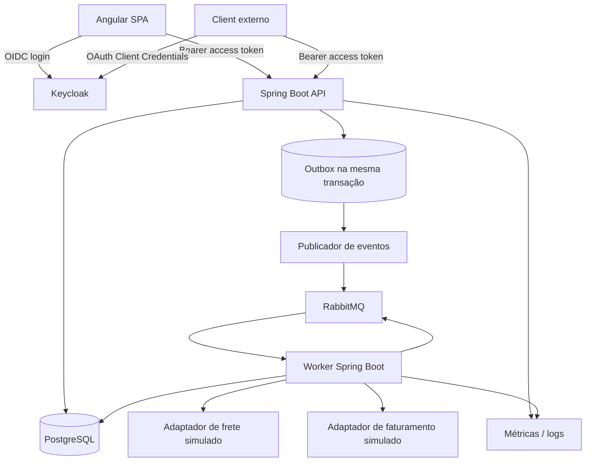

# FlowBridge — Guia de desenvolvimento e aprendizado com Claude Code

**Versão do documento:** 1.0  
**Data de referência dos preços:** 21 de outubro de 2026  
**Objetivo:** orientar o desenvolvimento de um projeto de portfólio com Java, Spring Boot, Angular, OAuth 2.0/OIDC, RabbitMQ, TDD e CI/CD, usando Claude Code com Claude Sonnet 5.5 como assistente de programação e tutor técnico.

> **Princípio central:** este projeto é uma atividade de aprendizado. O agente não deve simplesmente gerar código e seguir em frente. Deve explicar os conceitos antes ou durante a implementação, construir em incrementos pequenos, demonstrar os testes, apontar decisões e limitações e confirmar que você entendeu cada etapa. Você continua sendo responsável por revisar, executar, testar, modificar e conseguir explicar o código.

---

# 1. Instruções principais para o agente

Claude Code: leia este documento integralmente antes de iniciar. Use-o como especificação do projeto e como contrato de trabalho. Não tente implementar o projeto inteiro em uma única execução.

## 1.1 Seu papel

Atue simultaneamente como:

1. **Engenheiro de software:** implemente a aplicação seguindo os requisitos aprovados.
2. **Tutor:** explique os conceitos de forma didática, com exemplos relacionados ao FlowBridge.
3. **Revisor:** verifique código, arquitetura, segurança e testes.
4. **Mentor de TDD:** conduza a implementação a partir dos testes, mostrando RED → GREEN → REFACTOR.
5. **Parceiro de aprendizado:** ajude o proprietário do projeto a entender as decisões, não a apenas aceitar respostas prontas.

## 1.2 Regras obrigatórias de trabalho

- **Uma tarefa pequena de cada vez.** Não implemente todas as fases de uma só vez.
- **Ensine antes de abstrair.** Ao introduzir uma tecnologia ou padrão que ainda não foi estudado, explique primeiro: qual problema resolve, como funciona, quais alternativas existem e por que será usado aqui.
- **Não esconda a complexidade.** Se algo parecer mágico — por exemplo, injeção de dependência, transações, configuração OAuth ou ACK de mensagens — explique o mecanismo e o que pode falhar.
- **TDD real.** Para cada regra importante, escreva um teste que falha pela razão esperada, execute-o, implemente a menor mudança possível, execute novamente e refatore. Não afirme que um teste falhou ou passou sem executar o comando correspondente.
- **Sem implementação massiva não revisada.** Não gere dezenas de arquivos e só depois tente compilar. Trabalhe em incrementos verificáveis.
- **Não invente resultados.** Se um comando não foi executado, diga isso. Se um serviço não iniciou, descreva a falha real.
- **Preserve o que já funciona.** Antes de alterar arquivos, leia o código existente e verifique `git status`. Não sobrescreva alterações não relacionadas.
- **Não remova ou enfraqueça testes para fazer o build passar.** Corrija a implementação ou explique o desacordo de requisito.
- **Pergunte antes de expandir o escopo.** Não adicione Kafka, Kubernetes, microsserviços adicionais, serviços pagos ou dependências grandes sem apresentar justificativa.
- **Evite segredos.** Nunca grave senhas reais, tokens, chaves privadas ou credenciais no Git. Use `.env.example` com valores fictícios e arquivos locais ignorados pelo Git.
- **Sem dados reais.** Use dados sintéticos; nunca importe dados de cliente ou dados internos de empregadores.
- **Use documentação oficial.** Para compatibilidade de versões e configurações de segurança, consulte a documentação oficial atual. Informe quando uma decisão depende de versão.
- **Aplique segurança no servidor.** Esconder um botão no Angular não substitui autorização no backend.
- **Explique o motivo das abstrações.** Não crie interfaces, camadas ou padrões só para fazer o código parecer sofisticado.
- **Revisão humana obrigatória.** Ao final de cada tarefa, apresente um resumo e uma lista de perguntas para verificar o entendimento do proprietário.

## 1.3 Modelo de resposta ao terminar uma tarefa

Ao concluir cada tarefa, responda sempre com estas seções:

1. **O que foi construído:** arquivos e comportamento adicionados.
2. **Conceitos aprendidos:** explicações curtas, com analogias se forem úteis.
3. **Fluxo de execução:** como a requisição ou evento percorre o código.
4. **Testes executados:** comandos exatos e resultados observados.
5. **Decisões e alternativas:** por que foi escolhida a solução e quais são suas limitações.
6. **Como verificar manualmente:** instruções e exemplos de requisições.
7. **Perguntas de revisão:** de 2 a 5 perguntas para que o proprietário confirme a compreensão.
8. **Próxima tarefa sugerida:** uma só, sem executá-la até que a fase atual esteja validada.

Não use perguntas como barreira artificial a cada alteração trivial; use-as para consolidar conceitos importantes. Se houver erros, resolva-os com o proprietário de forma didática.

## 1.4 Como explicar conceitos

Para cada conceito novo, utilize esta estrutura:

- **Definição simples:** uma ou duas frases sem jargão excessivo.
- **Problema que resolve:** o que seria difícil sem ele.
- **Exemplo cotidiano:** analogia curta, se ajudar.
- **Onde aparece no FlowBridge:** arquivos, métodos e fluxo envolvidos.
- **Exemplo de código pequeno:** somente se ajudar a entender.
- **O que pode dar errado:** pelo menos um risco real.
- **Alternativas e trade-offs:** quando relevante.
- **Como testar:** como demonstrar que funciona.

O objetivo não é despejar um glossário antes de programar. Ensine os conceitos novamente quando forem usados no código.

---

# 2. Visão do projeto

## 2.1 Nome e objetivo

**FlowBridge — Order Integration & Automation Platform**

O FlowBridge é uma plataforma demonstrativa de integração e automação de pedidos. Ela recebe pedidos por uma API, valida os dados, grava o pedido, agenda seu processamento assíncrono, simula integrações com frete e faturamento e registra um histórico de cada etapa. Um painel Angular permite acompanhar o fluxo e investigar falhas.

O cenário representa desafios comuns de sistemas backend: serviços externos indisponíveis, requisições duplicadas, mensagens entregues novamente, inconsistência entre banco e mensageria, permissões inadequadas e necessidade de observar uma operação de ponta a ponta.

## 2.2 O que o sistema deve permitir

1. Um usuário humano faz login por meio do Keycloak e acessa o painel Angular.
2. Um sistema cliente obtém token OAuth 2.0 pelo fluxo Client Credentials e chama a API.
3. A API recebe um pedido, valida os campos e aplica idempotência.
4. O pedido é persistido no PostgreSQL.
5. O sistema registra um evento de saída associado à transação do pedido.
6. Um publicador envia eventos pendentes ao RabbitMQ.
7. Um worker independente consome o evento e executa etapas de processamento.
8. Adaptadores simulados consultam o frete e solicitam faturamento.
9. A aplicação mantém status, tentativas e histórico.
10. Falhas temporárias são tentadas novamente de forma limitada; falhas permanentes acabam em uma fila de mensagens não processadas (DLQ) e ficam visíveis na interface.
11. Usuários autorizados podem consultar detalhes e solicitar reprocessamento de forma auditável.
12. O projeto pode ser iniciado localmente com Docker Compose e validado por testes e CI.

## 2.3 Fora do escopo da primeira versão

Não implementar inicialmente:

- pagamentos reais;
- emissão fiscal oficial;
- integração com marketplaces, transportadoras ou ERP comerciais;
- dados pessoais reais;
- Kubernetes;
- arquitetura com muitos microsserviços;
- Kafka além de uma possível comparação futura;
- WebSockets como requisito obrigatório;
- alta disponibilidade de produção ou SLA real;
- deploy cloud pago obrigatório.

As integrações externas serão simuladas por adaptadores locais com contratos explícitos e comportamento controlável nos testes.

## 2.4 Critério de sucesso

O projeto estará pronto para portfólio quando uma pessoa que clonar o repositório puder seguir o README, iniciar o ambiente, autenticar-se, criar um pedido, observar o processamento, provocar uma falha simulada, entender o motivo e executar um reprocessamento autorizado. Os testes relevantes devem ser reproduzíveis e a arquitetura deve estar documentada.

---

# 3. Stack técnica e gestão de versões

As versões abaixo são **uma linha de base de projeto**, não uma ordem para escolher versões desatualizadas. Antes de iniciar, confira versões estáveis, requisitos e matriz de compatibilidade na documentação oficial. Registre as versões finais em `docs/decisions/technology-stack.md` e fixe as imagens e dependências.

| Tecnologia | Linha de base | Função |
|---|---|---|
| Java | 21 LTS | Linguagem principal do backend |
| Spring Boot | 3.5.x estável, ou outra linha mantida após verificação explícita | API REST e worker |
| Maven Wrapper | Maven 3.9.x compatível | Build reprodutível do Java |
| PostgreSQL | 17.x | Persistência relacional |
| RabbitMQ | 4.x com imagem de management | Broker de mensagens e painel administrativo local |
| Keycloak | 26.x estável compatível | Provedor OAuth 2.0 / OpenID Connect |
| Angular | 21.x ou linha estável suportada após verificação | SPA do painel |
| Node.js | Linha LTS aceita pela matriz oficial do Angular escolhido | Build do frontend |
| TypeScript | Versão exigida pela versão escolhida do Angular | Código frontend |
| Docker Compose | Versão estável atual | Ambiente local integrado |
| JUnit 5 | Gerenciado pelo Spring Boot quando possível | Testes unitários e de integração |
| Mockito / AssertJ | Versões compatíveis | Mocks e assertions expressivas |
| Testcontainers | Versão compatível com Java e JUnit | Testes usando dependências reais em containers |
| Flyway | Versão compatível com PostgreSQL e Spring Boot | Migrações do esquema do banco |
| springdoc-openapi | Versão compatível com Spring Boot 3.5 | Swagger / OpenAPI |
| JaCoCo | Versão estável | Relatório de cobertura de testes |
| Playwright | Versão estável compatível com Node | Testes end-to-end no navegador |
| GitHub Actions | Actions oficiais fixadas em versões verificadas; SHA imutável quando viável | Integração contínua |
| Prometheus / Grafana | Versões estáveis fixadas | Métricas e visualização |

## 3.1 Regras de compatibilidade

- Não misturar versões de Spring Boot, Spring Security, Hibernate, Jackson ou outros módulos do ecossistema sem necessidade. Prefira o gerenciamento de dependências do Spring Boot.
- Não utilizar `latest` nas imagens Docker. Fixe tags explícitas e documente a forma de atualizá-las.
- Use Maven Wrapper (`./mvnw`) para que o projeto não dependa de uma versão Maven global na máquina de quem o executar.
- Registre a versão do Node no README e use arquivo de versão se apropriado.
- Confirme que a versão selecionada do Angular suporta a versão de Node e TypeScript fixadas.
- Não atualize dependências automaticamente apenas por estarem disponíveis versões mais novas. Avalie compatibilidade, manutenção e justificativa.
- Se alguma versão-base tiver saído de suporte, escolha uma linha mantida e registre a mudança num ADR.

## 3.2 Dependências Java esperadas

Escolha as dependências conforme o módulo em que são realmente usadas. A API pode precisar de:

- `spring-boot-starter-web`;
- `spring-boot-starter-validation`;
- `spring-boot-starter-data-jpa`;
- `spring-boot-starter-security`;
- `spring-boot-starter-oauth2-resource-server`;
- `spring-boot-starter-amqp`;
- `spring-boot-starter-actuator`;
- Flyway e seu módulo de suporte PostgreSQL conforme exigido pela versão;
- driver JDBC PostgreSQL;
- `springdoc-openapi` compatível;
- JUnit, Mockito, AssertJ, Spring Boot Test e Testcontainers.

Não copie essa lista sem validar o que cada módulo precisa. Evite dependências duplicadas e ferramentas que não serão usadas.

## 3.3 Dependências Angular esperadas

- Angular e Angular CLI na mesma linha de versão;
- Angular Router;
- Reactive Forms;
- HttpClient;
- biblioteca OIDC compatível com Authorization Code + PKCE;
- biblioteca visual opcional, por exemplo Angular Material;
- ferramentas de teste compatíveis com a versão selecionada;
- Playwright para fluxo end-to-end.

A UI é funcional e demonstrável; não precisa ser uma aplicação comercial completa.

## 3.4 Fontes oficiais para verificar a stack

- Spring Boot — requisitos: https://docs.spring.io/spring-boot/3.5/system-requirements.html
- Angular — compatibilidade: https://angular.dev/reference/versions
- Angular — releases e suporte: https://angular.dev/reference/releases
- RabbitMQ — download: https://www.rabbitmq.com/docs/download
- Keycloak — Docker: https://www.keycloak.org/getting-started/getting-started-docker
- Testcontainers: https://testcontainers.com/guides/
- Spring Security OAuth 2.0: https://docs.spring.io/spring-security/reference/servlet/oauth2/index.html
- OpenAPI: https://springdoc.org/

---

# 4. Arquitetura do sistema

## 4.1 Visão geral

Use um **monólito modular para a API** e um **worker separado para processamento assíncrono**. Isso permite estudar limites entre módulos e comunicação por eventos sem enfrentar desde o primeiro dia os custos operacionais de muitos microsserviços.



## 4.2 Módulos da API

Organize por capacidade de negócio, não apenas por tipo de classe:

- `orders`: criação, consulta, regras e estados do pedido;
- `processing`: orquestração e visão geral do processamento;
- `integrations`: adaptadores, contratos e registros de chamadas simuladas;
- `outbox`: eventos pendentes e publicação confiável;
- `identity`: mapeamento de permissões quando necessário, sem implementar autenticação própria;
- `shared`: somente utilidades transversais reais, como tratamento global de exceções e configuração de observabilidade.

Dentro de cada módulo, separe API, aplicação, domínio e infraestrutura quando isso ajudar a impedir dependências inadequadas.

### Exemplo da responsabilidade de cada camada

- **API/controller:** recebe HTTP, valida formato de entrada, chama um caso de uso e transforma o resultado em resposta HTTP. Não deve conter regras de negócio complexas.
- **Aplicação/use case:** coordena o caso de uso, transações e dependências; por exemplo, criar um pedido.
- **Domínio:** regras de negócio, invariantes e transições de estado; deve evitar depender diretamente de HTTP ou RabbitMQ.
- **Infraestrutura:** repositórios JPA, configuração de banco, clientes externos, RabbitMQ e implementação de interfaces necessárias.

Não force essa separação em todos os arquivos se ela criar mais complexidade que benefício.

## 4.3 Estrutura sugerida de repositório

```text
flowbridge/
├── backend/
│   ├── pom.xml
│   ├── mvnw
│   └── src/
│       ├── main/java/com/flowbridge/
│       │   ├── FlowBridgeApplication.java
│       │   ├── shared/
│       │   │   ├── config/
│       │   │   ├── exception/
│       │   │   └── observability/
│       │   ├── orders/
│       │   │   ├── api/
│       │   │   ├── application/
│       │   │   ├── domain/
│       │   │   └── infrastructure/
│       │   ├── processing/
│       │   ├── integrations/
│       │   └── outbox/
│       └── test/java/com/flowbridge/
├── worker/
│   ├── pom.xml
│   └── src/
│       ├── main/java/com/flowbridge/worker/
│       │   ├── messaging/
│       │   ├── processing/
│       │   ├── integrations/
│       │   └── configuration/
│       └── test/java/com/flowbridge/worker/
├── frontend/
│   ├── package.json
│   └── src/app/
│       ├── core/
│       ├── layout/
│       ├── features/
│       │   ├── dashboard/
│       │   ├── orders/
│       │   ├── integrations/
│       │   └── failures/
│       └── shared/
├── infrastructure/
│   ├── compose.yaml
│   ├── keycloak/
│   ├── rabbitmq/
│   └── monitoring/
├── docs/
│   ├── architecture/
│   ├── decisions/
│   ├── api/
│   └── screenshots/
├── .github/workflows/
├── .claude/rules/
├── CLAUDE.md
├── README.md
├── CONTRIBUTING.md
├── LICENSE
└── .gitignore
```

A estrutura exata pode evoluir com justificativa e ADR. Não crie arquivos vazios apenas para preencher pastas.

---

# 5. Glossário didático: conceitos que precisam ser ensinados durante a implementação

Este glossário é um índice de aprendizado. O agente deve explicar os conceitos no contexto de cada tarefa, mesmo que já estejam resumidos aqui.

## 5.1 API REST, HTTP e JSON

**API** é um contrato que permite que sistemas diferentes se comuniquem. Neste projeto, a API recebe pedidos e devolve dados por HTTP. **REST** é um estilo de organização de APIs que usa recursos, representados por URIs, e semântica de métodos HTTP. **JSON** é um formato de dados usado no corpo das requisições e respostas.

Exemplo: `POST /api/v1/orders` cria uma solicitação de pedido; `GET /api/v1/orders/{id}` consulta um pedido específico. `POST` não significa automaticamente “salvar qualquer coisa”; o endpoint precisa ter contrato, validação e comportamento documentado.

Ensinar: códigos HTTP (`200`, `201`, `204`, `400`, `401`, `403`, `404`, `409`, `422` quando aplicável, `429` e `500`); headers; query parameters; paginação; versionamento; idempotência de métodos e como documentar contratos com OpenAPI.

## 5.2 Java, objetos e injeção de dependência

Uma classe define comportamento e dados; um objeto é uma instância da classe. Interfaces representam contratos. Composição permite construir um objeto com dependências sem herança desnecessária.

**Injeção de dependência** significa que uma classe recebe de fora as dependências de que precisa, em vez de criá-las manualmente. O Spring cria e conecta esses objetos (beans) conforme a configuração. Isso facilita trocar implementações e testar componentes isoladamente.

Ensinar: classes, interfaces, records/DTOs, encapsulamento, exceções, generics, streams apenas quando úteis, imutabilidade, escopo de beans e injeção por construtor. Evitar jargão sem exemplos.

## 5.3 Spring Boot

Spring é um ecossistema Java para criar aplicações. Spring Boot facilita configurar e executar aplicações Spring com autoconfiguração, starters e servidores integrados. Ele não elimina o funcionamento normal do Java; ele configura e conecta muitas peças.

Ensinar: `@SpringBootApplication`, controllers, services, repositories, configuração por `application.yml`, perfis, propriedades de ambiente, auto-configuração e como diagnosticar erro de inicialização.

## 5.4 DTOs e validação

**DTO (Data Transfer Object)** é um objeto pensado para transportar dados através de um limite, por exemplo entre HTTP e aplicação. Não precisa ser a mesma classe que representa a entidade persistida no banco.

Separar DTO e entidade impede expor campos internos acidentalmente e permite validar o contrato de entrada. Bean Validation usa anotações como `@NotBlank`, `@NotNull`, `@Positive` e `@Valid`.

Ensinar: por que não retornar entidades JPA diretamente; diferença entre validação de formato e regra de negócio; como devolver erros úteis sem vazar detalhes internos.

## 5.5 JPA, Hibernate, SQL e banco relacional

**SQL** consulta e modifica dados relacionais. **JPA** define uma API de persistência de objetos Java; **Hibernate** é uma implementação popular dessa especificação. **Spring Data JPA** reduz código repetitivo para acesso a dados.

Ensinar: entidade, chave primária, chave estrangeira, relações, índices, constraints, lazy/eager loading, N+1 queries, paginação, transações, migrations e diferença entre objeto Java e linha do banco.

Não tratar JPA como substituto para entender SQL. Inspecione queries importantes e explique índices e consultas com plano de execução quando fizer sentido.

## 5.6 Transações e ACID

Uma transação agrupa operações que precisam obedecer a uma unidade de consistência. ACID descreve atomicidade, consistência, isolamento e durabilidade. `@Transactional` do Spring pode delimitar transações, mas tem regras de propagação e limites: não torna automaticamente atômicos banco de dados e RabbitMQ juntos.

Ensinar: commit, rollback, isolamento, concorrência, deadlock, transações longas e por que chamadas HTTP externas dentro de transações podem causar problemas.

## 5.7 Flyway e migrations

Uma **migration** é uma mudança de esquema do banco versionada e registrada no repositório. Flyway aplica as migrações na ordem esperada, permitindo criar o banco a partir de um estado conhecido.

Ensinar: migração incremental, nomes como `V1__create_orders.sql`, banco vazio, ambientes novos e por que não depender de alteração automática de esquema em ambientes compartilhados.

## 5.8 Autenticação, autorização, OAuth 2.0, OIDC e JWT

- **Autenticação:** verifica quem é o usuário ou cliente.
- **Autorização:** define o que ele pode fazer.
- **OAuth 2.0:** estrutura de autorização que permite emitir tokens de acesso para clientes.
- **OpenID Connect (OIDC):** camada de identidade sobre OAuth 2.0; adiciona conceitos de login e ID token.
- **JWT:** formato de token com claims e assinatura; um JWT não é automaticamente seguro só por ter formato JWT.
- **Access token:** credencial apresentada ao serviço protegido.
- **Refresh token:** credencial usada, em fluxos apropriados, para obter novos tokens; deve ser protegida com cuidado.
- **Keycloak:** servidor de identidade que gerencia realms, clients, usuários, sessões e tokens.
- **PKCE:** prova criptográfica usada especialmente para proteger o fluxo Authorization Code de clientes públicos, como SPAs.
- **Client Credentials:** fluxo para comunicação máquina a máquina, sem usuário interativo.
- **Resource Server:** API que valida tokens de acesso e autoriza requisições.

Fluxo SPA esperado: Angular redireciona o usuário ao Keycloak, autenticação ocorre no provedor, a aplicação recebe o retorno do fluxo OIDC com PKCE e obtém acesso à API com token. Fluxo máquina a máquina: cliente autentica-se no token endpoint com credenciais do client e usa o access token para chamar a API.

Ensinar cuidadosamente diferença entre access token e ID token, emissor (`iss`), audiência (`aud`), expiração (`exp`), assinatura, roles e scopes. Confirmar como os claims emitidos pelo Keycloak são mapeados em authorities do Spring Security; não presumir que o formato é automático.

Não armazenar tokens no `localStorage` por conveniência. Escolher uma biblioteca OIDC confiável e documentar riscos do SPA. Não implementar senha própria, criptografia ou assinatura JWT manualmente.

## 5.9 RabbitMQ: broker, exchange, queue e routing key

Um **broker** recebe e encaminha mensagens. No RabbitMQ, produtores publicam mensagens em **exchanges**; as exchanges encaminham para **queues** conforme bindings e routing keys; consumidores recebem e processam mensagens.

- **Producer:** publica uma mensagem.
- **Consumer:** recebe e processa mensagem.
- **Exchange:** decide como rotear mensagens.
- **Queue:** mantém mensagens à espera de consumo.
- **Routing key:** informação usada em regras de roteamento.
- **ACK:** confirma ao broker que a mensagem foi processada com sucesso.
- **NACK/reject:** informa falha ou rejeição, conforme configuração pode permitir requeue ou dead-letter.
- **Prefetch:** limita o número de mensagens entregues mas não confirmadas para um consumidor.
- **DLQ (dead-letter queue):** fila que recebe mensagens que não puderam ser processadas conforme a política configurada.

O agente deve explicar as configurações usadas, o ciclo de vida de uma mensagem, o que significa confirmação de publicação e o que acontece se o worker cair no meio do processamento.

## 5.10 Processamento assíncrono e consistência eventual

Uma operação é **assíncrona** quando quem iniciou não precisa esperar todo o trabalho terminar na mesma requisição. A API pode confirmar que o pedido foi aceito enquanto um worker executa outras etapas. Isso aumenta flexibilidade e desacopla o tempo de vida da requisição, mas cria desafios de monitoramento, falha e consistência.

**Consistência eventual** significa que partes do sistema podem não refletir a mesma atualização imediatamente, mas convergem depois se o processamento concluir. A UI deve distinguir “recebido”, “em processamento”, “concluído” e “falhou”, sem prometer conclusão instantânea.

## 5.11 Retry, backoff, DLQ e poison message

**Retry** é uma nova tentativa depois de uma falha. **Backoff** aumenta o intervalo entre tentativas para reduzir pressão sobre um serviço instável. **DLQ** separa mensagens que esgotaram a política de entrega ou foram rejeitadas conforme a configuração. Uma **poison message** é uma mensagem que tende a falhar repetidamente por conteúdo inválido ou erro permanente.

Não reprocessar indefinidamente. Definir erros que são temporários (timeout, falha transitória) e permanentes (payload inválido, regra de negócio violada). Documentar quantidade máxima, intervalos, alertas e procedimento manual de recuperação.

## 5.12 Idempotência

Uma operação é idempotente quando repetir a mesma solicitação sob as mesmas condições não produz efeitos de negócio duplicados. Exemplo: se o cliente não recebe a resposta e repete a criação do pedido com a mesma chave de idempotência, o sistema não deve criar outro pedido.

A implementação deve considerar concorrência, persistência da chave com constraint adequada, payload repetido igual, payload diferente com a mesma chave e prazo de retenção. Não basta fazer `if` na aplicação: duas requisições simultâneas podem passar pela verificação, por isso a persistência deve proteger a regra.

Para processamento de mensagens, o consumidor deve ser idempotente: receber o evento novamente não pode criar uma segunda cobrança ou solicitação de faturamento. Neste projeto o faturamento é simulado, mas o princípio será exercitado.

## 5.13 Outbox Pattern

Problema: a API salva um pedido no PostgreSQL e tenta publicar evento no RabbitMQ. Se o banco confirmar e a publicação falhar, o pedido existe mas o evento não chega. Se o evento for publicado e a transação do banco falhar, o consumidor pode agir sobre algo que nunca foi confirmado.

Solução: salvar o pedido e uma linha `OutboxEvent` na **mesma transação do PostgreSQL**. Um publicador separado lê eventos pendentes, envia ao broker e registra o resultado. Assim, se o sistema cair antes de publicar, o evento continua registrado e pode ser tentado novamente.

O Outbox não torna o banco e RabbitMQ uma transação distribuída. O publicador pode enviar um evento e cair antes de marcar a linha como publicada; portanto, o mesmo evento pode ser publicado de novo. Por isso o consumidor também deve ser idempotente.

Ensinar polling, estado do evento, número de tentativas, bloqueio/concorrência entre publicadores, ordenação quando relevante e limpeza segura de eventos antigos. Para o escopo intermediário, comece com um publicador por instância e defina claramente a estratégia. Não introduza CDC/Debezium inicialmente.

## 5.14 “Exactly once” e garantias reais

Não afirmar que o sistema tem processamento exatamente uma vez apenas porque usa RabbitMQ, ACK ou Outbox. Em sistemas distribuídos, mensagens podem ser entregues novamente. O objetivo prático deste projeto é entrega confiável com efeitos de negócio idempotentes e observáveis. Descrever com precisão as garantias: por exemplo, “entrega pelo menos uma vez no limite definido, com consumidor idempotente”.

## 5.15 Docker e Docker Compose

**Imagem** é um pacote imutável que contém o necessário para executar um processo; **container** é uma instância isolada em execução. Docker Compose define serviços, redes, volumes, variáveis e dependências para executar vários componentes localmente.

Ensinar: imagem versus container, porta interna versus porta publicada, rede entre containers, volumes persistentes, health checks, variáveis de ambiente e por que `depends_on` sozinho não garante que o serviço esteja pronto para aceitar conexões.

Não colocar credenciais reais no `compose.yaml`. Usar valores de desenvolvimento e instruções explícitas de configuração.

## 5.16 Testes unitários, integração e end-to-end

- **Teste unitário:** verifica uma unidade pequena, com dependências externas isoladas quando apropriado.
- **Teste de integração:** verifica se componentes se comunicam corretamente, por exemplo repositório com PostgreSQL real ou produtor/consumidor com RabbitMQ.
- **E2E (end-to-end):** percorre um fluxo inteiro pela interface ou API como um usuário/cliente faria.
- **Mock:** substituto controlado para uma dependência; útil para simular resultados, mas não prova que a integração real funciona.
- **Testcontainers:** inicia dependências reais em containers durante os testes.

Ensinar por que cada tipo de teste existe e quando usar. Não testar implementação interna sem necessidade; testar comportamento observável. Para segurança e mensageria, combinar testes de configuração, integração e comportamento.

## 5.17 TDD

TDD significa **Test-Driven Development**. O ciclo RED → GREEN → REFACTOR começa com um teste que define o comportamento desejado e falha, seguido de implementação mínima e refatoração. O teste serve como exemplo executável do requisito.

Não basta escrever todos os testes depois do código e chamar isso de TDD. O agente deve mostrar os ciclos principais, principalmente para regra de negócio, idempotência, transições de estado e retry. Para configurar infraestrutura, um ciclo estritamente unitário pode não ser adequado; explique a adaptação usada.

## 5.18 Angular, SPA e OIDC no navegador

Angular é um framework TypeScript para construir interfaces web. Uma **SPA** (Single Page Application) navega e atualiza partes da interface sem recarregar o documento inteiro a cada interação. Componentes, serviços e roteamento separam a interface em partes reutilizáveis.

Ensinar: componentes, serviços, dependency injection do Angular, Router, Reactive Forms, HttpClient, interceptors, estados de loading/error/empty/success e testes. Ensinar também como o client OIDC realiza login e protege rotas sem substituir a autorização do backend.

O dashboard precisa ser funcional, não uma camada enorme de design. Preferir componentes claros, formulários validados, paginação e mensagens de erro úteis.

## 5.19 Observabilidade: logs, métricas e traces

- **Logs:** registros de eventos e erros com contexto.
- **Métricas:** contadores, gauges e histogramas agregados, por exemplo quantidade de pedidos por status e duração do processamento.
- **Traces:** caminho de uma operação entre componentes, com spans relacionados.
- **Correlation ID:** identificador usado para encontrar os logs associados a uma operação.
- **Actuator/Micrometer:** expõem informações de saúde e métricas na aplicação Spring.
- **Prometheus:** coleta métricas; **Grafana** ajuda a visualizá-las.

Não registrar tokens, senhas, segredos ou payloads sensíveis indiscriminadamente. Use o ID do pedido e um correlation ID para investigar problemas. Se tracing distribuído completo aumentar demais o escopo, comece com logs estruturados e métricas simples, documentando a evolução possível.

## 5.20 CI/CD e Git

**CI (Continuous Integration)** roda build e testes automaticamente quando o código muda. **CD** pode significar entrega ou implantação contínua; neste projeto, primeiro foque em integração contínua e build das imagens, sem prometer deploy automático em produção.

Ensinar: branch, commit, pull request, workflow, artifacts, secrets do CI e quality gates. O pipeline deve falhar se compilação ou testes obrigatórios falharem. Use permissões mínimas nas Actions e fixe versões verificadas.

---

# 6. Modelo de dados e regras de negócio

## 6.1 Entidades essenciais

| Entidade | Responsabilidade | Campos ilustrativos |
|---|---|---|
| `Order` | Pedido e estado geral | `id`, `externalReference`, `status`, `currency`, `total`, `createdAt`, `updatedAt` |
| `OrderItem` | Itens do pedido | `id`, `orderId`, `sku`, `description`, `quantity`, `unitPrice` |
| `ProcessingAttempt` | Tentativas de processamento | `id`, `orderId`, `step`, `attemptNumber`, `status`, `startedAt`, `finishedAt`, `errorCode` |
| `IntegrationExecution` | Histórico da integração | `id`, `orderId`, `integrationType`, `status`, `externalReference`, `durationMs`, `errorCode` |
| `OutboxEvent` | Evento a publicar | `id`, `aggregateId`, `eventType`, `payload`, `createdAt`, `publishedAt`, `attempts`, `status` |
| `IdempotencyRecord` ou tabela equivalente | Requisições repetidas | `key`, `requestHash`, `resourceId`, `responseReference`, `createdAt` |

O agente deve propor o esquema definitivo, explicar cardinalidades e restrições SQL e manter as decisões em ADR ou documentação de dados. Não é obrigatório que todos os nomes/entidades fiquem exatamente assim se houver justificativa simples.

## 6.2 Estados do pedido

Fluxo inicial:

`RECEIVED → PROCESSING → COMPLETED`

Em caso de falha:

`PROCESSING → FAILED`

Um reprocessamento autorizado pode permitir:

`FAILED → PROCESSING`

O estado de cada integração deve ser separado do estado global do pedido. Um pedido pode ter o frete concluído e o faturamento falhado. O status global deve seguir uma regra definida e testada, não ser alterado arbitrariamente por cada componente.

## 6.3 Endpoints iniciais

| Método | Endpoint | Finalidade |
|---|---|---|
| `POST` | `/api/v1/orders` | Criar pedido |
| `GET` | `/api/v1/orders` | Listar com paginação/filtros |
| `GET` | `/api/v1/orders/{id}` | Consultar detalhes |
| `GET` | `/api/v1/orders/{id}/timeline` | Consultar histórico |
| `POST` | `/api/v1/orders/{id}/reprocess` | Solicitar reprocessamento autorizado |
| `GET` | `/api/v1/integrations` | Listar integrações |
| `GET` | `/api/v1/integrations/{id}/executions` | Consultar execuções |
| `GET` | `/api/v1/dashboard/summary` | Indicadores do dashboard |

Usar DTOs e contrato OpenAPI. Respostas de erro devem seguir uma estrutura consistente, preferencialmente Problem Details/RFC 9457 se compatível com a stack escolhida. Não vazar stack traces para clientes.

## 6.4 Idempotência da criação

O cliente envia uma chave estável no header `Idempotency-Key` (ou outra convenção documentada). A API deve:

1. verificar se a chave já foi usada;
2. comparar hash/representação do pedido anterior com o payload recebido;
3. retornar a resposta previamente associada se a chave e a requisição forem equivalentes;
4. retornar conflito claro se a mesma chave for reutilizada para um pedido materialmente diferente;
5. garantir proteção contra requisições concorrentes por meio de constraint/transação no banco.

O período de retenção da chave deve ser documentado. Não implementar armazenamento infinito sem discutir limpeza.

---

# 7. Segurança: requisitos OAuth 2.0 e OIDC

## 7.1 Clientes e fluxo

Configurar Keycloak com um realm para desenvolvimento e, no mínimo:

- client público para o Angular usando Authorization Code + PKCE;
- client confidencial para teste de Client Credentials, com segredo exclusivamente local;
- papéis ou scopes para permissões do usuário e da integração;
- URLs de redirect e origins explicitamente configuradas para ambiente local.

Não considerar export de realm com senha/secret real como arquivo compartilhável. Se persistir configuração, remover segredos e documentar a configuração necessária.

## 7.2 Papéis sugeridos

| Papel | Capacidades previstas |
|---|---|
| `ADMIN` | Consulta operacional ampla e administração das ações simuladas |
| `OPERATOR` | Consulta de pedidos e solicitação de reprocessamentos autorizados |
| `VIEWER` | Somente leitura |
| `INTEGRATION_CLIENT` | Criar pedidos e consultar somente os recursos permitidos pelo contrato da integração |

O agente deve desenhar o mapeamento de roles/scopes para claims do token e authorities do Spring Security. Para o cliente de integração, considerar scopes como `orders:write` e `orders:read`, se essa estratégia for escolhida. Defina as regras com testes antes de espalhá-las por controllers.

## 7.3 Critérios de aceite de segurança

- Sem token: `401 Unauthorized`.
- Token inválido, expirado, com emissor incorreto ou assinatura inválida: requisição rejeitada.
- Token válido, mas sem permissão: `403 Forbidden`.
- Token de um cliente de integração não ganha permissões de usuário administrador.
- Configuração de audience é explícita se necessária; a API não aceita audiência errada silenciosamente.
- O logout e expiração de sessão são tratados de acordo com a biblioteca OIDC usada.
- Nenhum segredo real no Git, nos logs ou nas capturas de tela.
- A documentação ensina como obter um token local de teste e como verificar a autorização sem expor credenciais.

---

# 8. Mensageria e confiabilidade

## 8.1 Evento inicial

Defina um evento versionado, por exemplo `OrderSubmitted.v1`, com um envelope explícito:

```json
{
  "eventId": "uuid",
  "eventType": "OrderSubmitted",
  "eventVersion": 1,
  "occurredAt": "2026-01-01T12:00:00Z",
  "correlationId": "uuid",
  "aggregateId": "order-uuid",
  "payload": {
    "orderId": "order-uuid"
  }
}
```

Este é um exemplo ilustrativo, não payload obrigatório definitivo. O agente deve explicar cada campo e definir serialização e compatibilidade. Evite incluir dados pessoais desnecessários no evento.

## 8.2 Filas e roteamento

Desenhe e documente:

- exchange de eventos do FlowBridge;
- routing key para pedido submetido;
- fila de trabalho do worker;
- política de tentativas e espera entre tentativas;
- dead-letter exchange/queue;
- confirmação de publicação e ACK do consumidor;
- limite de mensagens simultâneas por consumidor.

Escolha uma estratégia de retry compatível com RabbitMQ. Não misture requeue imediato infinito com backoff, pois isso pode produzir loop agressivo. As tentativas devem ter limite e as mensagens falhadas devem ser visíveis.

## 8.3 Outbox

Implementar em duas etapas:

1. Fazer API e worker trocarem uma mensagem simples e testar o fluxo básico.
2. Substituir a publicação ingênua na criação do pedido por Outbox com recuperação de eventos pendentes.

A Outbox deve persistir na mesma transação do pedido. Definir estado, tentativas, timestamps e concorrência. Simular queda entre salvar a outbox, publicar e marcar como publicado; demonstrar que o evento pode ser recuperado e que a duplicidade não repete o efeito de negócio.

## 8.4 Critérios de aceite de mensageria

- Uma criação válida chega ao worker.
- O status do pedido é atualizado de forma consistente.
- Uma mensagem repetida não duplica efeitos.
- Uma falha transitória gera novas tentativas somente até o limite.
- Uma falha permanente é encaminhada para DLQ conforme a configuração.
- O painel mostra que houve falha e as informações úteis para investigar, sem expor dados sensíveis.
- Um evento Outbox não publicado pode ser encontrado e enviado posteriormente.
- Uma falha no worker não apaga histórico já persistido.
- O README descreve as garantias e limitações reais; não prometer exactly-once.

---

# 9. Plano detalhado por fases

A previsão é de aproximadamente **55 a 90 horas efetivas de desenvolvimento e estudo**, podendo aumentar conforme a quantidade de revisões, interrupções e conceitos novos. O tempo serve apenas para planejamento. Não significa que o agente deva executar todo o escopo de uma vez.

Cada fase só avança após seus critérios de aceite serem validados pelo proprietário.

## Fase 0 — Planejamento, requisitos e decisões

**Estimativa:** 3–5 horas.

### Tarefas

1. Inspecionar o repositório atual e o ambiente.
2. Confirmar a stack e a compatibilidade das versões.
3. Escrever requisitos funcionais e não funcionais.
4. Criar diagrama Mermaid da arquitetura.
5. Definir o modelo de dados inicial.
6. Definir contratos REST e eventos.
7. Criar ADRs para decisões principais.
8. Escrever plano de testes e riscos.

### Entregáveis

- `README.md` inicial;
- `docs/architecture/overview.md`;
- `docs/architecture/domain-model.md`;
- `docs/decisions/ADR-001-modular-monolith.md`;
- `docs/decisions/ADR-002-authentication.md`;
- `docs/decisions/ADR-003-messaging.md`;
- `docs/decisions/technology-stack.md`.

### Aceite

- Escopo explícito, sem funcionalidades vagas.
- Versões e dependências justificadas e documentadas.
- Diagramas compreensíveis.
- Riscos de segurança e confiabilidade identificados.
- Nenhum código de negócio produzido nesta fase sem necessidade.

## Fase 1 — Repositório, ferramentas e ambiente local

**Estimativa:** 4–6 horas.

### Tarefas

1. Criar estrutura do repositório.
2. Inicializar backend e worker com Maven Wrapper.
3. Inicializar frontend Angular.
4. Criar `compose.yaml` com PostgreSQL, RabbitMQ, Keycloak e serviços da aplicação conforme forem implementados.
5. Configurar variáveis de ambiente locais e `.env.example` seguro.
6. Criar health checks e endpoints de health.
7. Criar CI mínimo para build e testes vazios/estruturais.

### Aceite

- Backend e frontend compilam.
- `docker compose config` passa.
- Os containers necessários ficam saudáveis.
- `depends_on` e health checks não são confundidos; o README explica a inicialização.
- Segredos locais não são rastreados pelo Git.
- Uma pessoa nova consegue iniciar o ambiente com as instruções iniciais.

## Fase 2 — Domínio, banco e API REST

**Estimativa:** 8–12 horas.

### Ordem TDD

1. Testar criação de pedido válido.
2. Testar campos ausentes, inválidos e quantidades/preços inválidos.
3. Definir estados e transições permitidas.
4. Implementar entidades e regras de domínio.
5. Criar migrations Flyway.
6. Implementar repository e persistência.
7. Implementar DTOs e controller.
8. Adicionar paginação, filtros e tratamento de exceções.
9. Documentar endpoints no OpenAPI.

### Aceite

- API recebe e consulta pedidos.
- Validações não dependem só do frontend.
- Migrations constroem banco vazio.
- Controllers não contêm toda a regra de negócio.
- DTOs impedem exposição direta de entidades internas.
- Testes unitários e de integração são executados e passam.
- Erros HTTP têm formato coerente.

## Fase 3 — TDD e idempotência

**Estimativa:** 5–7 horas.

### Tarefas

1. Explicar idempotência e cenário de timeout.
2. Criar teste para repetir a mesma chave e mesmo payload.
3. Criar teste para chave repetida com payload diferente.
4. Criar teste de concorrência com requisições simultâneas.
5. Implementar persistência de chave/hash e proteção por constraint.
6. Definir comportamento de expiração/retention.
7. Documentar exemplos com `curl`.

### Aceite

- Repetir solicitação não gera pedido duplicado.
- Reutilizar chave com payload diferente tem resposta definida e documentada.
- Teste de concorrência não cria duplicidade.
- A regra não depende exclusivamente de uma checagem em memória.

## Fase 4 — OAuth 2.0, OIDC e Keycloak

**Estimativa:** 5–8 horas.

### Tarefas

1. Explicar autenticação, autorização, OAuth 2.0, OIDC, JWT e PKCE.
2. Configurar realm e clientes de desenvolvimento.
3. Configurar Angular para Authorization Code + PKCE.
4. Configurar Spring como Resource Server.
5. Mapear roles/scopes e proteger endpoints.
6. Configurar Client Credentials para cliente de integração.
7. Escrever testes de `401`, `403` e acesso permitido.
8. Documentar como obter tokens de teste sem expor secrets.

### Aceite

- Login do Angular funciona.
- Token válido é aceito; token inválido/expirado é rejeitado.
- Permissões são verificadas no backend.
- Client Credentials funciona em chamada de teste.
- Não há senha ou assinatura JWT customizada.
- Os secrets locais não entram no repositório.

## Fase 5 — RabbitMQ e worker assíncrono

**Estimativa:** 8–12 horas.

### Tarefas

1. Ensinar broker, exchange, queue, routing key, ACK e redelivery.
2. Definir envelope de evento versionado.
3. Configurar exchanges e filas.
4. Publicar evento após criação de pedido na versão inicial.
5. Fazer worker consumir e atualizar o pedido.
6. Implementar adaptador simulado de frete.
7. Implementar adaptador simulado de faturamento.
8. Criar testes de integração com RabbitMQ real via Testcontainers quando apropriado.

### Aceite

- API não espera o processamento inteiro para responder ao pedido submetido.
- Worker pode ser iniciado separadamente.
- Evento é correlacionável com o pedido.
- Erros de processamento ficam registrados.
- Testes demonstram o comportamento com broker real, não apenas mocks.

## Fase 6 — Outbox, retries, DLQ e reprocessamento

**Estimativa:** 8–12 horas.

### Tarefas

1. Explicar o problema de dupla escrita banco + broker.
2. Implementar `OutboxEvent` na mesma transação do pedido.
3. Criar publicador recuperável de eventos pendentes.
4. Implementar consumidor idempotente.
5. Definir retry limitado e backoff.
6. Configurar dead-letter handling.
7. Criar histórico de tentativas.
8. Criar endpoint de reprocessamento autorizado e auditável.
9. Adicionar testes para cada modo de falha.

### Aceite

- Falha após gravação do pedido mas antes da publicação não perde permanentemente o evento.
- Publicação repetida não repete efeitos de negócio.
- Retry termina no limite definido.
- Mensagens problemáticas chegam à DLQ e podem ser investigadas.
- Reprocessamento não apaga a história anterior.
- Documentação explica que a entrega pode ocorrer mais de uma vez.

## Fase 7 — Frontend Angular

**Estimativa:** 8–12 horas.

### Telas

- login e layout principal;
- dashboard com contadores consultados na API;
- listagem de pedidos com paginação e filtros;
- detalhes do pedido e timeline;
- integrações e execuções;
- falhas e botão de reprocessamento conforme permissões.

### Tarefas

1. Criar serviços Angular para APIs.
2. Criar modelos TypeScript alinhados aos DTOs.
3. Integrar OIDC.
4. Criar formulários reativos e validação.
5. Tratar loading, erro, vazio e sucesso.
6. Criar testes unitários de componentes/serviços.
7. Criar teste Playwright para o fluxo principal.

### Aceite

- Usuário consegue entrar e sair.
- Pedido pode ser criado/consultado conforme o contrato implementado.
- Status e timeline vêm da API, não de dados fictícios hardcoded.
- Erros são apresentados com clareza.
- A UI não finge que o backend autorizou uma operação.
- Layout é responsivo e tem acessibilidade básica.

## Fase 8 — Observabilidade, pipeline e revisão

**Estimativa:** 6–10 horas.

### Tarefas

1. Adicionar logs estruturados com correlation ID.
2. Configurar métricas básicas de API e processamento.
3. Configurar Actuator/Micrometer.
4. Integrar Prometheus/Grafana se o custo de complexidade for razoável.
5. Consolidar CI para backend e frontend.
6. Rodar testes de integração e E2E selecionados.
7. Medir cobertura; objetivo inicial de 80% em domínio/casos de uso sem perseguir números artificiais.
8. Fazer revisão de segurança, performance e dependências.

### Aceite

- Cada pedido pode ser rastreado pelo ID/correlation ID.
- Nenhum token ou segredo aparece nos logs.
- CI reprova build ou testes obrigatórios que falham.
- Relatórios de cobertura são gerados.
- Testes de integração usam dependências reais onde isso é relevante.
- Vulnerabilidades e limitações conhecidas são documentadas.

## Fase 9 — README, demo e lançamento do portfólio

**Estimativa:** 4–6 horas.

### Tarefas

1. Escrever README final com requisitos, arquitetura e quick start.
2. Adicionar diagrama de arquitetura e eventos.
3. Documentar variáveis de ambiente e secrets.
4. Adicionar exemplos de API e link Swagger.
5. Capturar telas sem dados/segredos reais.
6. Gravar uma demonstração curta.
7. Criar publicação LinkedIn transparente sobre o papel do Claude Code.
8. Fazer clone limpo em diretório separado e validar o README do início ao fim.

### Aceite

- Instalação funciona do zero seguindo documentação.
- O repositório não contém secrets ou dados pessoais reais.
- Todos os claims no README e LinkedIn são verificáveis.
- O proprietário consegue explicar arquitetura, testes e limites do projeto.

---

# 10. Estratégia de testes e critérios de qualidade

## 10.1 Matriz de testes

| Tipo | Ferramenta sugerida | Finalidade |
|---|---|---|
| Domínio/unidade | JUnit 5, AssertJ | Regras, cálculos, transições e validações de domínio |
| Caso de uso | JUnit 5, Mockito quando adequado | Coordenação e comportamento do caso de uso |
| API | Spring Boot Test, MockMvc | Contratos HTTP, validações, respostas e segurança |
| Persistência | Testcontainers + PostgreSQL | SQL, constraints, migrations e concorrência |
| Mensageria | Testcontainers + RabbitMQ | Roteamento, ACK, entrega, retry e DLQ |
| Segurança | Spring Security Test + ambiente de integração apropriado | Claims, roles, scopes, `401` e `403` |
| Angular | Ferramentas de teste suportadas pela versão | Serviços, componentes, formulários e estados |
| E2E | Playwright | Login, navegação e fluxo de pedido em ambiente integrado |

## 10.2 Cenários obrigatórios

- Pedido inválido não é persistido.
- Requisição repetida com chave idempotente não cria duplicidade.
- Mesma chave com payload diferente retorna conflito documentado.
- Concorrência não viola idempotência.
- Banco executa migrations do zero.
- Usuário não autenticado não acessa endpoint protegido.
- Usuário autenticado sem permissão não executa ação proibida.
- Evento outbox não publicado pode ser recuperado.
- Mensagem entregue duas vezes não duplica o efeito de faturamento simulado.
- Falha temporária tenta novamente até o limite configurado.
- Falha permanente vai para DLQ conforme a política.
- Reprocessamento é autorizado e preserva o histórico.
- Logs não incluem tokens, senhas, segredos ou payload sensível.
- A UI mostra corretamente estados pendentes, sucesso e falha.

## 10.3 Cobertura

Use JaCoCo para medir cobertura. Meta inicial: cerca de 80% em classes de domínio e casos de uso, ajustada à estrutura real. O número não é um selo de qualidade: testes podem executar linhas sem verificar resultados significativos. O agente deve destacar lacunas de cenários em vez de apenas aumentar porcentagem.

---

# 11. CI/CD e GitHub Actions

## 11.1 Pipeline esperado

1. Checkout.
2. Configuração de Java/Node fixados.
3. Build backend com Maven Wrapper.
4. Testes unitários e de integração selecionados.
5. Lint/build/testes do Angular.
6. Checagem de formatação e análise estática.
7. Relatório de cobertura.
8. Verificação de dependências vulneráveis e secrets.
9. Build de imagens Docker, se a infraestrutura estiver pronta.
10. Bloqueio do merge quando os checks obrigatórios falharem.

## 11.2 Segurança de CI

- Fixar actions em versões verificadas e, para maior segurança, em SHA imutável.
- Usar `permissions` mínimos.
- Não imprimir secrets nos logs.
- Não rodar scripts não confiáveis de pull requests com credenciais privilegiadas.
- Não automatizar deploy de produção sem requisitos adicionais e aprovação explícita.

## 11.3 Exemplo inicial simplificado para backend

```yaml
name: Backend CI

on:
  pull_request:
  push:
    branches: [main]

permissions:
  contents: read

jobs:
  verify:
    runs-on: ubuntu-latest
    steps:
      - uses: actions/checkout@v4
      - uses: actions/setup-java@v4
        with:
          distribution: temurin
          java-version: '21'
          cache: maven
      - name: Verify backend
        working-directory: backend
        run: ./mvnw --batch-mode verify
```

Este YAML é apenas ilustrativo e ainda usa tags de action, não SHA imutável. Antes de adotá-lo no projeto final, conferir versões atuais, fixar actions conforme a política escolhida e adicionar dependências de infraestrutura necessárias aos testes de integração. Adicionar workflow separado ou job apropriado para o frontend.

---

# 12. Organização do trabalho com Claude Code

## 12.1 Antes de iniciar uma sessão

1. Execute `git status`.
2. Abra `CLAUDE.md` e leia a fase atual.
3. Confirme que testes anteriores estão verdes, quando aplicável.
4. Peça ao agente para resumir a tarefa, arquivos prováveis e critérios de aceite.
5. Não permita alterações amplas sem plano.

## 12.2 Ciclo recomendado por funcionalidade

1. **Explique:** o agente explica o conceito e o problema.
2. **Planeje:** delimita a menor entrega.
3. **Teste primeiro:** apresenta e executa o teste RED.
4. **Implemente:** muda o mínimo necessário.
5. **Valide:** executa o teste GREEN e a suíte relevante.
6. **Refatore:** remove duplicação ou melhora nomes sem alterar comportamento.
7. **Revise:** inspeciona diff e riscos.
8. **Ensine:** explica o fluxo e faz perguntas de revisão.
9. **Registre:** atualiza documentação/ADR e cria commit somente após aprovação do proprietário.

O agente não deve criar commits em nome do proprietário sem que isso tenha sido explicitamente solicitado. O proprietário deve revisar `git diff` antes de aceitar mudanças.

## 12.3 Configuração sugerida do `CLAUDE.md`

Criar um arquivo na raiz com um resumo operacional e uma referência a este guia:

```markdown
# FlowBridge — instruções para Claude Code

Leia `FLOWBRIDGE_GUIA_DE_DESENVOLVIMENTO_CLAUDE_CODE.md` antes de implementar tarefas.

## Princípios
- Projeto educacional: explique antes de implementar conceitos novos.
- Implemente somente uma pequena tarefa por vez.
- Use TDD para regras de negócio e comportamento importante.
- Não declare testes aprovados sem executá-los.
- Leia o código e `git status` antes de editar.
- Nunca remova testes para forçar um build verde.
- Não grave secrets ou dados reais no repositório.
- Preserve contratos e decisões documentadas; proponha ADR para mudanças arquiteturais.
- Prefira soluções simples e justificadas.
- Mantenha backend, worker e frontend executáveis.
- Depois de cada tarefa, explique arquivos alterados, conceitos, testes, limitações e perguntas de revisão.
- Não implemente fases futuras sem validação da fase atual.
```

## 12.4 Regras opcionais em `.claude/rules/`

- `backend.md`: camadas, injeção de dependência, transações, validação e testes.
- `messaging.md`: envelope de eventos, ACK, retry, DLQ, Outbox e idempotência.
- `security.md`: OAuth/OIDC, tokens, secrets, autorização e logs.
- `frontend.md`: Angular, formulários, estados, OIDC e acessibilidade.
- `testing.md`: TDD, Testcontainers, cobertura e quality gates.

O agente deve evitar repetir toda a documentação em cada regra. Coloque detalhes específicos de cada área e mantenha o guia principal como referência.

---

# 13. Prompts de trabalho para as fases

Use um prompt por tarefa/fase; revise o resultado antes de prosseguir.

## Prompt A — Planejamento inicial

```text
Leia integralmente FLOWBRIDGE_GUIA_DE_DESENVOLVIMENTO_CLAUDE_CODE.md e CLAUDE.md, se já existirem. Inspecione o repositório e execute git status.

Nesta tarefa, não implemente funcionalidades de negócio.

Quero que você:
1. confirme as versões compatíveis usando documentação oficial;
2. proponha requisitos funcionais e não funcionais;
3. produza diagramas Mermaid de componentes, entidades e fluxo de eventos;
4. descreva endpoints REST e contratos de eventos;
5. proponha ADRs para monólito modular, worker, OAuth/OIDC, RabbitMQ e Outbox;
6. liste riscos, dependências entre fases e critérios de aceite;
7. explique os conceitos usados em linguagem didática.

Não introduza Kafka, Kubernetes, serviços pagos ou microsserviços adicionais. Não faça suposições silenciosas. Apresente as decisões pendentes antes de codificar.
```

## Prompt B — Ambiente e esqueleto

```text
Implemente somente a fase atual de estrutura e ambiente do FlowBridge.

Antes de editar, explique o que são projetos Maven, Maven Wrapper, Angular CLI, containers, imagens, portas, volumes, redes e health checks, relacionando cada conceito ao repositório.

Crie o esqueleto do backend, worker, frontend e Docker Compose em incrementos pequenos. Não implemente ainda regras de pedido, OAuth nem mensageria de negócio.

Execute os comandos reais de build e verificação. Não declare sucesso sem evidências. Ao terminar, liste arquivos alterados, comandos executados, resultados e como eu posso repetir cada verificação.
```

## Prompt C — Criação de pedido com TDD

```text
Implemente somente a criação e consulta de pedidos usando TDD.

Primeiro, ensine e confirme a compreensão dos conceitos de REST, controller, service/use case, domínio, DTO, validação, JPA, Hibernate, SQL, transação e Flyway.

Escreva o teste inicial e execute-o para demonstrar RED pela razão esperada. Implemente o mínimo para GREEN e depois refatore. Faça isso em pequenos ciclos.

Inclua Order, OrderItem, persistência PostgreSQL, migrations, validação, paginação, tratamento global de erros e documentação OpenAPI.

Não implemente nesta tarefa OAuth, RabbitMQ, Outbox ou frontend. Não use mocks para fingir que migrations e persistência real funcionam. Use testes de integração quando necessário.

Ao terminar, execute os testes relevantes, explique o fluxo de uma requisição desde o controller até o banco e faça de 2 a 5 perguntas de revisão.
```

## Prompt D — Idempotência

```text
Implemente a idempotência da criação de pedidos seguindo TDD.

Antes de codificar, explique timeout de HTTP, repetição de requisição, chave de idempotência, hash de payload, constraint única, concorrência e por que um if em memória não é suficiente.

Teste pelo menos: primeira requisição, repetição equivalente, chave reutilizada com payload diferente, duas requisições concorrentes e comportamento após restart da aplicação. Defina e documente a retenção dos registros.

Implemente o mínimo necessário, execute os testes e explique a garantia real que o sistema oferece e seus limites.
```

## Prompt E — OAuth 2.0 / OIDC / Keycloak

```text
Implemente a segurança do FlowBridge com Keycloak, Spring Security Resource Server e Angular OIDC.

Antes de alterar arquivos, explique autenticação versus autorização, OAuth 2.0, OpenID Connect, JWT, access token, ID token, Authorization Code + PKCE, Client Credentials, issuer, audience, roles e scopes.

Configure Authorization Code + PKCE no Angular e Resource Server JWT no backend. Configure Client Credentials para um cliente de integração. Defina o mapeamento de claims/roles/scopes explicitamente; não assuma o formato do Keycloak.

Escreva testes para ausência de token, token inválido/expirado, emissor/audiência errados quando aplicável, usuário sem permissão e acesso autorizado. Não escreva autenticação ou assinatura JWT própria e não comite secrets. Explique como testar manualmente sem expor credenciais.
```

## Prompt F — RabbitMQ e worker

```text
Implemente o fluxo assíncrono com RabbitMQ e worker independente.

Antes de codificar, explique producer, consumer, broker, exchange, queue, routing key, ACK, NACK, redelivery, prefetch, consistência eventual e correlation ID.

Defina um contrato versionado de evento. Configure filas e roteamento explícitos. O worker deve processar frete/faturamento simulado, atualizar o status e registrar tentativas.

Adicione testes de integração com RabbitMQ real por Testcontainers onde apropriado. Mostre o que acontece quando o worker falha antes e depois de realizar uma etapa. Não use apenas mocks para declarar que mensageria funciona.
```

## Prompt G — Outbox, retry e DLQ

```text
Implemente Outbox Pattern, retries limitados, dead-letter handling e reprocessamento auditável.

Explique antes de codificar o problema de dupla escrita PostgreSQL + RabbitMQ, por que Outbox grava o pedido e o evento na mesma transação, por que ainda pode ocorrer publicação repetida e por que consumidores precisam ser idempotentes.

Implemente em pequenos passos: tabela OutboxEvent; gravação transacional; publisher recuperável; consumidor idempotente; retry com backoff e limite; DLQ; histórico e endpoint de reprocessamento autorizado.

Teste queda entre as etapas, mensagens duplicadas, falha transitória, falha permanente e reprocessamento. Não afirme exactly-once. Documente as garantias reais e como investigar as mensagens.
```

## Prompt H — Angular

```text
Implemente o painel Angular apenas com os contratos REST existentes.

Explique componentes, serviços, Router, Reactive Forms, HttpClient, interceptors, OIDC, estados de carregamento/erro/vazio/sucesso e testes antes de introduzi-los.

Crie dashboard, listagem paginada, detalhe com timeline, visão de integrações e tela de falhas/reprocessamento. Dados devem vir da API; não fixe números fictícios no dashboard. Integre Authorization Code + PKCE com biblioteca OIDC adequada. Não armazene tokens em localStorage por conveniência e não trate guards de rota como autorização de segurança.

Inclua testes para serviços/componentes e um E2E do fluxo principal. Respeite os contratos backend; liste lacunas da API antes de propor alterações.
```

## Prompt I — Revisão final de qualidade

```text
Faça primeiro uma revisão, sem alterar o código, como se estivesse avaliando o FlowBridge para uma vaga Java pleno.

Analise lógica, TDD, qualidade dos testes, OAuth/OIDC, autorização, transações, concorrência, idempotência, Outbox, retry, DLQ, SQL, N+1 queries, validação, logs, dependências, acessibilidade, Docker, CI e documentação.

Classifique achados por severidade, cite arquivos e passos para reproduzir. Separe falhas reais de melhorias opcionais. Depois proponha um plano de correção priorizado e aguarde a minha aprovação antes de uma refatoração ampla.
```

---

# 14. Custo estimado usando Claude Sonnet 5.5

**A estimativa é aproximada, não um preço garantido.** O custo real depende de quantas sessões serão usadas, do tamanho do contexto enviado em cada sessão, de quantas vezes o agente lê novamente os arquivos, da quantidade de testes/erros e do uso de cache de prompts.

## 14.1 Dois modelos de cobrança diferentes

### Opção A — Claude Code por assinatura

Se você usa Claude Code conectado a uma assinatura elegível do Claude, o gasto é principalmente o valor do plano mensal escolhido, sujeito aos limites de uso do plano. A assinatura e a API pay-as-you-go são sistemas distintos. Verifique no seu plano/conta a disponibilidade do Sonnet 5.5 no Claude Code, os limites vigentes e se eventual uso extra será cobrado separadamente.

Os artigos oficiais consultados listam historicamente/atualmente planos individuais com estes preços de referência: Pro US$ 20/mês, Max 5x US$ 100/mês e Max 20x US$ 200/mês. Preços, limites, elegibilidade, tributos e disponibilidade podem mudar. Não interprete a assinatura como uso ilimitado.

### Opção B — Claude API / Console com cobrança por token

A documentação oficial do Claude Sonnet 5.5 consultada em **21/10/2026** informa os preços básicos:

| Tipo de token | Preço por 1 milhão de tokens |
|---|---:|
| Entrada (input) não cacheada | US$ 2,00 |
| Saída (output) | US$ 10,00 |
| Escrita de cache de 5 minutos | US$ 2,50 |
| Escrita de cache de 1 hora | US$ 4,00 |
| Leitura de cache | US$ 0,10 |

O uso de ferramentas e o conteúdo de suas chamadas também entram no cálculo de tokens conforme as regras oficiais. O cache pode reduzir o custo de conteúdo repetido, mas suas escritas também têm tarifa; o resultado depende do padrão real de uso. Não aplique um desconto percentual presumido sem observar o consumo.

## 14.2 Cenários de orçamento para o projeto completo

Para ter uma estimativa inicial comparável, usei três cenários de consumo **hipotéticos**, calculados pelo preço base de input/output e sem descontar prompt caching. São números para orçamento, não medições de um projeto executado.

| Cenário | Input total faturável sem cache | Output total | Cálculo base | Total em USD |
|---|---:|---:|---|---:|
| Econômico | 10 milhões | 2 milhões | 10 × US$ 2 + 2 × US$ 10 | **US$ 40** |
| Provável para muitas iterações | 30 milhões | 5 milhões | 30 × US$ 2 + 5 × US$ 10 | **US$ 110** |
| Intensivo | 60 milhões | 10 milhões | 60 × US$ 2 + 10 × US$ 10 | **US$ 220** |

O cenário provável pressupõe uso frequente do agente para implementação e depuração ao longo de várias fases. O cenário intensivo considera reimplementações, sessões longas, leitura repetida de arquivos, testes e correções adicionais. Um projeto pode sair desses intervalos se houver muitas sessões de contexto extenso ou revisão/regeração de grandes blocos.

### Conversão indicativa para reais

Para comparação, usando uma cotação de referência de **R$ 5,0336 por US$ 1 em 21/10/2026**, sem IOF, spread, tributos, tarifas do meio de pagamento ou variação do câmbio:

| Cenário | USD | Conversão indicativa |
|---|---:|---:|
| Econômico | US$ 40 | **R$ 201,34** |
| Provável | US$ 110 | **R$ 553,70** |
| Intensivo | US$ 220 | **R$ 1.107,39** |

Uma reserva de 20% para consumo acima do previsto levaria os cenários aproximadamente para US$ 48 (R$ 241,61), US$ 132 (R$ 664,44) e US$ 264 (R$ 1.328,87), respectivamente. Essa reserva é uma margem de orçamento, não uma previsão adicional garantida.

## 14.3 Como controlar o custo na prática

1. **Comece com limite baixo:** se usar a API, defina um orçamento/limite de gasto e notificações na plataforma antes de iniciar.
2. **Use tarefas pequenas:** não peça para ler e reescrever todo o repositório quando apenas um módulo mudou.
3. **Mantenha instruções concisas:** `CLAUDE.md` deve resumir as regras e apontar para os documentos relevantes; evite repetir milhares de palavras em todos os prompts.
4. **Faça commits funcionais:** isso facilita encerrar contextos e retomar com uma tarefa claramente definida.
5. **Evite regeneração total:** peça diagnóstico e um diff pequeno antes de uma reescrita ampla.
6. **Inspecione logs de uso/faturamento:** registre tokens de entrada, saída, cache e chamadas por fase se a interface disponível permitir.
7. **Não confunda assinatura com API:** confirme qual credencial e método de cobrança o Claude Code está usando.
8. **Considere uso do Sonnet para a maioria do trabalho:** modelos mais caros não são necessários para cada alteração trivial; esta estimativa, porém, considera Sonnet 5.5 nas tarefas.
9. **Teste o cache de prompt:** use o comportamento que o cliente Claude Code oferece e observe o relatório real, sem supor que todo contexto se torna cache hit.

## 14.4 Como medir o custo real por fase

Mantenha `docs/cost-log.md` com uma tabela simples:

| Data | Fase/tarefa | Modelo | Input | Output | Cache read/write | Custo informado pelo fornecedor |
|---|---|---|---:|---:|---:|---:|
| preencher | Fase 1 | Sonnet 5.5 | preencher | preencher | preencher | preencher |

Ao final de cada fase, registre o consumo real, caso o console o disponibilize. Depois da fase 2 ou 3, atualize as projeções com base no gasto médio por fase; essa estimativa própria será muito mais útil do que supor o custo a partir das horas de trabalho.

## 14.5 Fontes oficiais de preços e planos

- Claude Sonnet 5.5 — visão geral e preço: https://platform.claude.com/docs/en/models/sonnet-5-5/overview
- Preços do Claude Platform/API: https://platform.claude.com/docs/en/about-claude/pricing
- Novidades do Sonnet 5.5: https://platform.claude.com/docs/en/models/sonnet-5-5/whats-new-sonnet-5-5
- Planos Claude: https://support.claude.com/pt/articles/11049762-escolha-um-plano-claude
- Claude Code e assinatura: https://support.claude.com/pt/articles/11145838-use-claude-code-com-seu-plano-pro-ou-max
- Referência cambial indicativa em 21/10/2026: https://anystat.ai/live/currencies/brl

Os preços e planos precisam ser rechecados na data da contratação. O custo em reais pode mudar mesmo que o consumo de tokens seja igual.

---

# 15. GitHub, README e apresentação final

## 15.1 README final

O README deve conter, nesta ordem:

1. nome, descrição e problema que resolve;
2. funcionalidades;
3. tecnologias e versões;
4. diagrama de arquitetura;
5. pré-requisitos;
6. configuração segura de ambiente;
7. comandos para executar;
8. configuração de Keycloak;
9. exemplos de uso da API;
10. como acessar Swagger e painel;
11. como executar testes;
12. decisões arquiteturais importantes;
13. limites conhecidos e possíveis evoluções;
14. screenshots e vídeo;
15. licença.

## 15.2 Demonstração sugerida de 2 a 4 minutos

1. Abrir a aplicação e mostrar login.
2. Criar pedido de demonstração.
3. Mostrar status inicial e evento/worker processando.
4. Mostrar o pedido concluído ou suas etapas.
5. Provocar deliberadamente uma falha simulada.
6. Abrir timeline/logs e explicar o erro.
7. Mostrar retry/DLQ e reprocessamento quando aplicável.
8. Mostrar os testes e o workflow do GitHub Actions.

Não mostrar tokens, secrets, senhas ou dados reais na gravação.

## 15.3 Checklist de lançamento

- [ ] Clone limpo executa seguindo README.
- [ ] Backend, worker e frontend compilam.
- [ ] Docker Compose inicia dependências.
- [ ] Migrations funcionam em banco vazio.
- [ ] Login, token de integração e autorização são demonstráveis.
- [ ] Testes unitários e de integração obrigatórios passam.
- [ ] CI passa em branch limpa.
- [ ] Idempotência, Outbox, retry e DLQ são testados.
- [ ] Logs não contêm segredos.
- [ ] Documentação e diagramas condizem com o código.
- [ ] Capturas de tela usam dados sintéticos.
- [ ] Publicação de LinkedIn não reivindica competências que não foram aprendidas e verificadas.

---

# 16. Como falar do projeto com honestidade no LinkedIn

O objetivo é poder dizer que **você idealizou, conduziu, estudou, revisou, testou e domina o projeto**, desde que isso reflita o trabalho feito. Como Claude Code será usado ativamente para gerar, explicar e revisar código, evite afirmar que nenhuma ferramenta de IA foi usada ou apresentar código gerado sem revisão como se tivesse sido escrito manualmente do zero.

Uma descrição transparente continua valorizando seu trabalho:

> Desenvolvi o FlowBridge como projeto de estudo e portfólio, utilizando Java, Spring Boot, Angular, OAuth 2.0/OIDC, RabbitMQ e PostgreSQL. Usei o Claude Code como ferramenta de apoio para explorar conceitos, acelerar tarefas e revisar soluções, mantendo a responsabilidade pelas decisões, validação, testes e compreensão da implementação. O foco foi aprender na prática TDD, processamento assíncrono, idempotência, Outbox Pattern e observabilidade.

Você pode dizer que o projeto é seu e que o aprendizado foi conduzido por você. A expressão “100% feito manualmente por mim, sem IA” não seria precisa se o agente gerar partes substanciais do código. O melhor argumento em entrevista é mostrar que você compreende o sistema, consegue explicar as decisões, reproduzir os testes e fazer mudanças sem depender cegamente do agente.

## Exemplo de publicação

```text
🚀 Projeto de estudo: FlowBridge — integração e automação de pedidos

Estou desenvolvendo o FlowBridge para aprofundar meus conhecimentos em Java e Spring Boot, com foco em desafios de backend que aparecem em sistemas reais: integração entre serviços, processamento assíncrono e recuperação de falhas.

No projeto estou aplicando:
• Java e Spring Boot
• Angular
• OAuth 2.0 / OpenID Connect com Keycloak
• PostgreSQL e Flyway
• RabbitMQ e worker assíncrono
• TDD com JUnit e testes de integração
• Idempotência, Outbox Pattern, retry e DLQ
• Docker, GitHub Actions e observabilidade

Estou usando o Claude Code como ferramenta de apoio ao aprendizado e à implementação. Minha prioridade é compreender as decisões, validar o comportamento com testes e conseguir explicar cada parte da arquitetura.

O projeto é educacional: as integrações de frete e faturamento são simuladas.

Código-fonte: [link do repositório]
Demonstração: [link do vídeo]

#Java #SpringBoot #Angular #Backend #TDD #RabbitMQ #SoftwareEngineering
```

Antes de publicar, substitua os links, remova funcionalidades que ainda não estejam implementadas e só mencione tecnologias realmente usadas no código final.

---

# 17. Perguntas para consolidar o aprendizado

Ao final do projeto, o proprietário deve conseguir responder sem depender de uma resposta gerada naquele momento:

1. Por que escolheu monólito modular + worker em vez de muitos microsserviços?
2. Qual é a diferença entre autenticação e autorização?
3. O que OAuth 2.0 resolve e o que OIDC adiciona?
4. Qual a diferença entre access token, ID token e JWT como formato?
5. Por que uma chave de idempotência precisa ser protegida no banco contra concorrência?
6. O que acontece se o pedido for salvo e a publicação da mensagem falhar?
7. Como o Outbox Pattern reduz esse problema e por que ainda pode haver duplicidade?
8. Por que o consumidor precisa ser idempotente?
9. Qual é a diferença entre ACK, retry e DLQ?
10. Por que não prometer exactly-once?
11. Quando um teste unitário com Mockito é suficiente e quando precisa de PostgreSQL/RabbitMQ real?
12. Como TDD ajudou a definir o design de uma regra de negócio?
13. Como o frontend autentica o usuário sem ser a autoridade final de autorização?
14. Como encontrar os logs relacionados a um pedido que falhou?
15. O que o CI verifica automaticamente e o que ainda exige revisão humana?
16. Quais limitações do projeto você declararia numa entrevista?

Se alguma resposta não estiver clara, transforme-a em uma nova sessão de estudo com um exemplo pequeno. Não precisa expandir o sistema para provar o conceito; às vezes um teste ou um diagrama basta.

---

# 18. Ordem recomendada para começar hoje

1. Crie o repositório `flowbridge`.
2. Salve este documento na raiz, com o nome `FLOWBRIDGE_GUIA_DE_DESENVOLVIMENTO_CLAUDE_CODE.md`.
3. Peça ao Claude Code para ler o documento e produzir apenas o plano da Fase 0.
4. Revise a stack e os ADRs antes de criar a aplicação.
5. Construa a Fase 1 e valide o ambiente local.
6. Progrida uma fase por vez, sem pular testes nem explicações.
7. Registre as decisões e o custo real por fase.
8. Ao final, publique o que foi implementado de verdade e descreva corretamente o uso de IA como ferramenta de apoio.

**Definição de pronto do projeto inteiro:** você consegue executar a aplicação a partir de um clone limpo, reproduzir seus testes, demonstrar uma operação bem-sucedida e uma falha recuperável, e explicar com suas palavras por que cada tecnologia foi usada, o que ela resolve e quais limites ainda existem.
