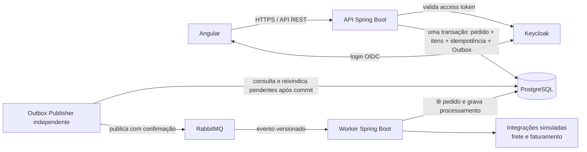

# FlowBridge

**Order Integration & Automation Platform**

FlowBridge é um projeto pessoal de aprendizado e portfólio sobre integração e automação de pedidos. A plataforma pretende receber pedidos por uma API REST, persistir a intenção de processamento de forma confiável e executar etapas assíncronas com histórico e recuperação de falhas. Frete e faturamento serão simulados com dados sintéticos; não são integrações comerciais.

## Estado atual do projeto

**O planejamento documental da Fase 0 está concluído e aprovado; a aplicação ainda não foi implementada.**

## Objetivo e escopo

O objetivo é fortalecer o portfólio e aprofundar conhecimentos de backend com Java e Spring Boot, explorando também integração entre sistemas, processamento assíncrono, segurança, persistência, testes e qualidade de software.

O escopo planejado inclui uma API de pedidos, autenticação de pessoas e clientes máquina, isolamento de pedidos por `client_id`, processamento assíncrono de frete e faturamento simulados, histórico de execução, idempotência, Outbox, retry/DLQ e um dashboard operacional.

Pagamentos reais, emissão fiscal, integrações comerciais, endereços e dados pessoais reais, alta disponibilidade/SLA produtivo, Kubernetes, Kafka obrigatório e cloud paga estão fora do escopo inicial.

## Arquitetura planejada

- **Angular** será a interface de operações e cliente OIDC para login humano.
- **API Spring Boot** será um monólito modular responsável por contratos REST, autorização, pedidos e gravação transacional do evento Outbox.
- **PostgreSQL** será a fonte de verdade compartilhada. API e worker terão credenciais distintas e grants mínimos; um usuário separado será responsável pelas migrations.
- **Outbox Publisher** será um processo independente: consulta eventos pendentes na tabela Outbox depois do commit da transação da API e os publica no RabbitMQ. A API não chama o publisher nem publica diretamente no broker.
- **RabbitMQ** transportará eventos versionados ao worker.
- **Worker Spring Boot** processará as etapas assíncronas e registrará estado, tentativas e resultados. Não validará tokens OIDC: a conexão RabbitMQ é autenticada pela infraestrutura e o worker também valida envelope, versão, origem e identificadores, deduplica mensagens e usa permissões PostgreSQL restritas.
- **Keycloak** emitirá tokens OAuth 2.0/OIDC. A API valida os access tokens e aplica autorização no servidor. O hostname local canônico planejado é `keycloak.flowbridge.test`.

Pedidos criados por clientes máquina são isolados por `client_id` em todas as operações, inclusive consultas individuais por UUID. UUID inexistente e UUID fora do escopo do cliente recebem a mesma resposta `404`.

## Decisões técnicas principais

- **Idempotência:** chave delimitada por `client_id`, retida por 24 horas. Dentro da janela, repetição equivalente devolve a resposta original; payload diferente resulta em conflito. A expiração não remove pedido nem histórico.
- **Retry:** uma execução inicial e até três retries, com atrasos de 5, 30 e 120 segundos. Jitter fica fora do escopo inicial.
- **Reprocessamento:** exige motivo e refaz a etapa que falhou e seus descendentes inválidos no grafo explícito e versionado. Resultados anteriores só são preservados quando estado, versão/regra, entradas e pré-requisitos continuam válidos. As arestas entre `FREIGHT` e `BILLING` serão definidas antes de implementar o workflow.
- **Dados de frete:** zona de origem, zona de destino e peso total em gramas; sem endereços reais.
- **Entrega de eventos:** pedido e evento Outbox são gravados na mesma transação. A publicação é pelo menos uma vez; o worker deduplica pelo identificador do evento e não se promete `exactly once`.
- **Banco compartilhado:** API e worker têm credenciais e permissões separadas; migrations usam uma credencial própria, sem DDL ou superuser para processos runtime.

Os detalhes e alternativas estão registrados nos [ADRs](docs/decisions/).

## Stack aprovada

| Tecnologia | Versão aprovada | Papel planejado |
|---|---:|---|
| Java | 21 LTS | Runtime da API e do worker |
| Spring Boot | 4.1.2 | Framework da API e do worker |
| Angular | 22 | Dashboard web |
| Node.js | 24 LTS | Ferramentas, build e testes do frontend |
| TypeScript | 6.0.x | Linguagem do frontend |
| PostgreSQL | 18.x | Persistência relacional |
| RabbitMQ | 4.4.x | Broker de mensagens |
| Keycloak | 26.8.x | Provedor de identidade |
| Maven Wrapper | 3.10.0, compartilhado na raiz | Build reproduzível dos módulos Java, com seleção explícita de POM por `-f` |

O [ADR-005 — stack aprovada](docs/decisions/technology-stack.md) registra compatibilidade, alternativas e validações ainda necessárias ao preparar os módulos.

## Documentação e ADRs

- [Visão geral da arquitetura](docs/architecture/overview.md)
- [Requisitos](docs/architecture/requirements.md)
- [Modelo de domínio](docs/architecture/domain-model.md)
- [Modelo de dados](docs/architecture/data-model.md)
- [Contratos REST](docs/architecture/api-contracts.md)
- [Contratos de eventos RabbitMQ](docs/architecture/event-contracts.md)
- [Roadmap de desenvolvimento](docs/architecture/development-roadmap.md)
- [Resumo da Fase 0](docs/architecture/phase-0-summary.md)
- [Decisões arquiteturais (ADR-001 a ADR-004)](docs/decisions/)
- [ADR-005 — versões aprovadas do stack](docs/decisions/technology-stack.md)
- [Especificação funcional e técnica principal](FLOWBRIDGE_GUIA_DE_DESENVOLVIMENTO_CLAUDE_CODE_REENVIO.md)

## CI e validações

O repositório público está em [github.com/lorran-camilo/flowbridge](https://github.com/lorran-camilo/flowbridge). O workflow do GitHub Actions executa em Pull Requests e na branch principal, com actions fixadas por SHA e permissões mínimas. Os jobs de build e teste são condicionados à existência dos manifests dos módulos; jobs ignorados por módulos ausentes não significam que esses builds ou testes passaram.

Na Fase 0 foram feitas verificações documentais, de links e do material visual, registradas no [resumo da Fase 0](docs/architecture/phase-0-summary.md). Essas verificações não são testes de software.

## Testes e implementação

Ainda não há comandos de execução ou testes de aplicação a apresentar. Quando os módulos forem criados, cada entrega seguirá TDD para regras importantes e usará testes de integração com PostgreSQL, RabbitMQ ou Keycloak real quando os critérios exigirem comprovar a integração.

## Aprendizado e uso de IA

O projeto é conduzido pelo proprietário, responsável por estudar, revisar, testar, validar e compreender as soluções. Ferramentas e agentes de IA serão usados como apoio didático e técnico para estudar conceitos, entender tecnologias, comparar alternativas, analisar problemas e revisar código. O uso de IA não substitui a revisão e a responsabilidade do proprietário.

O [registro de aprendizado](docs/learning/LEARNING_LOG.md) separa conceitos apresentados daqueles que o proprietário confirmar ter aprendido. Os materiais de LinkedIn são rascunhos para revisão; nada é publicado automaticamente.

## Roadmap e próximos passos

O [roadmap](docs/architecture/development-roadmap.md) organiza o trabalho em entregas incrementais e preserva a revisão humana entre fases. O próximo trabalho de implementação só começa mediante solicitação do proprietário.

Pendências reais para fases futuras:

- Definir e testar as arestas do grafo entre `FREIGHT` e `BILLING` antes de implementar reprocessamento.
- Fixar versões de patch e validar builds, imagens e integrações no ambiente local durante a preparação dos módulos.
- Implementar e testar discovery/issuer do Keycloak, grants PostgreSQL, Outbox Publisher recuperável, consumidor idempotente, retry, DLQ e topologia RabbitMQ.
- Definir detalhes técnicos de OpenAPI durante sua elaboração, sem alterar as regras de negócio aprovadas.
- Definir políticas operacionais de retenção/expurgo de Outbox, tentativas, timeline e DLQ, além de TTL/DLX, antes de uso produtivo.

Integrações comerciais, pagamentos, emissão fiscal, disponibilidade produtiva e publicação no LinkedIn permanecem fora do escopo desta etapa.
