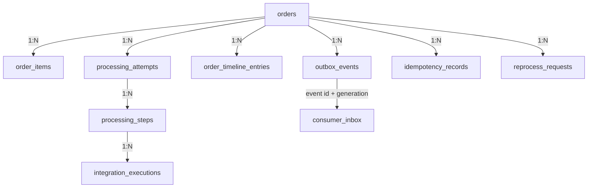
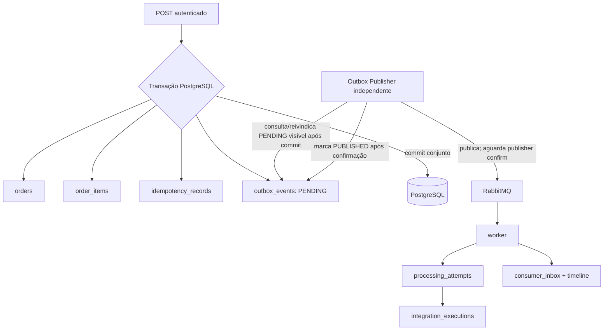

# FlowBridge — modelo de dados proposto

**Estado:** modelo aprovado na Fase 0; migrations não criadas.
**Banco proposto:** PostgreSQL 18.6, conforme [ADR-005](../decisions/technology-stack.md).

O modelo protege regras importantes no banco porque duas requisições ou dois workers podem agir ao mesmo tempo. A aplicação valida para dar respostas úteis; constraints garantem que concorrência ou erro de programação não persistam estados inválidos. Tipos e tamanhos abaixo são propostas lógicas; migrations futuras decidirão tipos concretos após aprovação.

## Diagrama conceitual

`ORDER_TIMELINE_ENTRIES`, `REPROCESS_REQUESTS`, `PROCESSING_STEPS` e `CONSUMER_INBOX` suportam histórico, dependências, auditoria e deduplicação. O guia exige os comportamentos, mas não fixa nomes físicos. `CONSUMER_INBOX` pode ser combinado com histórico se uma constraint equivalente garantir idempotência.

## Entidades e constraints

### `orders`

Representa o agregado do pedido e estado de negócio.

- `id`: UUID, PK.
- `client_id`: identificador autenticado e validado do cliente máquina que criou o pedido; obrigatório para pedidos de integração. Identifica o escopo de propriedade.
- `external_reference`: texto limitado, nullable e informativo; não há unicidade aprovada.
- `origin_zone_code`, `destination_zone_code`: códigos sintéticos obrigatórios para o simulador, validados contra conjunto permitido.
- `total_weight_grams`: inteiro positivo informado no pedido para o simulador.
- `status`: enum/text com CHECK para `RECEIVED`, `PROCESSING`, `COMPLETED`, `FAILED`.
- `currency`: código ISO 4217 de três letras (proposta a confirmar).
- `total`: decimal exato, não ponto flutuante; `CHECK total >= 0`.
- `processing_generation`: inteiro positivo iniciando em 1; aumenta em cada reprocessamento aprovado.
- `created_at`, `updated_at`: timestamps UTC.
- `client_id` é indexado com `created_at` e status para listagem escopada. Todas as consultas de cliente incluem `client_id`, inclusive UUID direto e subrecursos.
- Índices: `(status, created_at DESC)` para operação/listagem; `created_at DESC` para relatórios. Índices adicionais somente após filtros aceitos e plano de consulta.

### `order_items`

- `id`: UUID, PK; `order_id`: FK com `ON DELETE RESTRICT` ou cascade apenas se agregado for removido (retenção não definida; recomendação é não apagar pedidos).
- `line_number`: começa em 1, `UNIQUE(order_id, line_number)`.
- `sku`: não vazio e limitado; `description`: sintética/opcional conforme contrato.
- `quantity`: inteiro `> 0`; `unit_price`: decimal exato `>= 0`.
- Índice `(order_id, line_number)` apoia leitura ordenada; a constraint única cria índice correspondente.
- `orders.total` deve coincidir com soma de linhas. Não confiar em cálculo enviado pelo cliente; serviço calcula e testa.

### `idempotency_records`

Uma chave impede duplicar a criação se o cliente perdeu a resposta HTTP e repetiu a chamada.

- `client_id`: claim autenticado estável e validado; não usar access token bruto.
- `idempotency_key`: valor do header, tamanho e formato limitados.
- `request_hash`: hash de representação canônica dos campos materialmente relevantes do pedido; algoritmo e canonicalização documentados.
- `order_id`: FK ao pedido.
- `response_status` e `response_snapshot` (ou referência reconstruível) permitem repetir resultado original sem criar outro pedido.
- `created_at`, `expires_at` para expurgo após retenção acordada.
- Constraint obrigatória: `UNIQUE(client_id, idempotency_key)`.
- Índice para expurgo em `expires_at`; leitura primária usa índice único.
- Mesma chave/hash: retornar o resultado original. Mesma chave/hash diferente: `409 Conflict`. Em concorrência, a constraint única é a árbitra; a aplicação captura colisão e lê registro vencedor.
- `expires_at = created_at + 24h`. A reutilização após expiração é permitida e não apaga pedido/histórico. A checagem de expiração e substituição da chave expirada devem ser atômicas por cliente/chave; expurgo físico pode ocorrer depois sem ampliar a janela de idempotência.

### `processing_steps`

Representa cada etapa lógica de uma geração e é a base para decidir o escopo de reprocessamento.

- `id`, `order_id`, `generation`, `step_key` estável (por exemplo `FREIGHT`, `BILLING`), `status`, `rule_version`, `input_hash`, `started_at`, `finished_at`, `error_code`, `reused_from_step_id` opcional.
- Constraint `UNIQUE(order_id, generation, step_key)`; índice por pedido/generation/status.
- Dependências formam um grafo acíclico explícito versionado com o fluxo. Nós iniciais: `FREIGHT` e `BILLING`; a existência/direção de arestas não é definida pela especificação e deve ser aprovada ao modelar o workflow na Fase 6. Ordem textual não cria dependência.
- Reprocessamento começa na etapa falha e inclui seus descendentes. Etapa concluída é reutilizada só se sucesso, regra/versão e hash de entradas forem iguais e seus pré-requisitos continuarem válidos. Nesse caso a linha da nova geração usa estado `REUSED` e `reused_from_step_id` referencia a etapa de origem; o histórico da execução original permanece, sem inserir integração fictícia duplicada. Se os critérios falharem, a etapa e seus descendentes são executados novamente.
- `integration_executions.processing_step_id` referencia a etapa e registra cada chamada/efeito, inclusive resultados históricos de gerações anteriores.

### `outbox_events`

- `id`: UUID que também é `eventId`.
- `aggregate_id`: FK ao pedido; `event_type`, `event_version` fixam contrato.
- `payload`: JSONB validado pela versão do evento. Proposta: só `orderId` e geração, sem dados sensíveis.
- `status`: `PENDING`, `PUBLISHING` (claim/lease), `PUBLISHED`, `FAILED`/`DEAD` conforme política final.
- `publish_attempts`, `created_at`, `next_attempt_at`, `published_at`, `last_error_code`, `locked_by`, `claim_token` UUID e `locked_until` obrigatórios enquanto `PUBLISHING`.
- Índice parcial em `(next_attempt_at, created_at)` para linhas pendentes; índice `(aggregate_id, created_at)` para diagnóstico.
- Restrição `event_version > 0`, tentativas `>= 0`; `published_at` presente apenas quando estado `PUBLISHED`.
- **Claim atômico:** numa única transação curta, selecionar uma linha elegível (`PENDING` cujo `next_attempt_at` venceu, ou `PUBLISHING` cujo lease expirou) com `FOR UPDATE SKIP LOCKED`, gravar `PUBLISHING`, `locked_by`, novo `claim_token` e `locked_until`, e confirmar o claim. Duas instâncias não podem reivindicar a mesma linha simultaneamente. A chamada de rede acontece depois do commit do claim, sem manter lock/transação aberta.
- **Recuperação de publisher:** se o processo morrer antes de publicar ou antes de concluir a atualização, o lease expira. Outro publisher pode reivindicar atomicamente a linha vencida e retomá-la; falhas conhecidas devolvem a linha a `PENDING` com `next_attempt_at` segundo a política de publicação aprovada na implementação. Não deixar `PUBLISHING` sem prazo de recuperação. Atualizações finais condicionam-se ao `claim_token` atual (e lease válido), para um publisher antigo não sobrescrever o claim de outra instância.
- A janela “RabbitMQ confirmou publish e publisher caiu antes de atualizar Outbox” pode duplicar mensagem: após expirar o lease, outro publisher republica o mesmo envelope com o mesmo `eventId`, tipo, agregado e geração. O worker deduplica pela constraint da inbox `(consumer_name, event_id, generation)` e pelas chaves idempotentes dos efeitos. O Outbox só é marcado `PUBLISHED` depois de confirmação e roteamento válidos.

### `processing_attempts` e `integration_executions`

`ProcessingAttempt` é uma execução do workflow para um pedido/generation; `IntegrationExecution` registra uma chamada individual de frete ou faturamento. Assim, “redelivery da mensagem” não é confundida com chamada de integração.

- `processing_attempts`: FK, `generation`, `attempt_number`, status (`RUNNING`, `SUCCEEDED`, `RETRYABLE_FAILURE`, `PERMANENT_FAILURE`), início/fim e código de erro seguro.
- Unique proposta `(order_id, generation, attempt_number)`; índice `(order_id, started_at)`.
- `integration_executions`: FK ao attempt, tipo (`FREIGHT`, `BILLING`), status, referência simulada, duração, error code, timestamps. O tipo identifica o adaptador lógico; não há entidade configurável de integração. A consulta operacional por tipo usa `GET /integrations/{integrationType}/executions`.
- Índices `(order_id, created_at)` e `(processing_attempt_id, integration_type)`.
- Uma chave idempotente de efeito por pedido/etapa/integração evita duplicar o efeito de negócio ao reentregar mensagem. Um novo evento/generation não autoriza duplicar um efeito concluído que foi preservado.
- Não gravar stack trace, token ou payload externo sensível no histórico operacional.

### `consumer_inbox`

Registra conclusão/estado do consumidor por identidade de evento, worker e geração.

- `event_id`: UUID do envelope; `consumer_name`; `generation`; status e `delivery_count`.
- Constraint proposta `UNIQUE(consumer_name, event_id, generation)`.
- Índices por estado e atualizado_em para localizar processamentos pendentes/estagnados.
- Não marcar definitivamente como processado antes de completar o efeito durável. Falhas transitórias deixam registro retomável; sucesso registra `COMPLETED`.
- Em chamadas externas simuladas, persistir também chave estável de operação no adaptador para que redelivery não repita efeito.

### `order_timeline_entries` e `reprocess_requests`

- Timeline é append-only para mudanças de estado, cada integração, retry, falha e reprocessamento.
- Evento da timeline contém categoria, texto curto, `safe_details` com allowlist, `occurred_at` e `correlation_id` (campo proposto).
- Índice `(order_id, occurred_at, id)` para timeline ordenada.
- Reprocess request registra quem pediu (`sub`/client ID validado), quando, motivo (proposta), geração criada e correlation ID.
- `reason` é obrigatório para reprocessamento. Guardar ator (`sub` humano), data, texto limitado, geração criada e correlation ID.
- Auditoria deve permitir reconstituição, não sobrescrever ou apagar entrada anterior.

## Relacionamentos e fluxo transacional

API grava pedido, itens, idempotência e evento Outbox na mesma transação PostgreSQL. A API não chama o Outbox Publisher. Só após o commit, o processo independente consulta/reivindica a linha pendente, publica no RabbitMQ e, após confirmação/roteamento, marca a linha como publicada. O Outbox elimina a janela de perda entre commit do pedido e tentativa de publicação; não faz PostgreSQL e RabbitMQ confirmarem como uma só transação. Por isso a mensagem é pelo menos uma vez e os efeitos precisam ser idempotentes.

### Roles PostgreSQL e ownership

| Credencial | Responsabilidade e permissões |
|---|---|
| `flowbridge_migrator` (nome lógico) | Usada somente por Flyway para migrations e ownership/DDL do schema. Não é configurada em API/worker durante runtime. |
| `flowbridge_api` | DML de pedidos/itens, idempotency records, Outbox e solicitações de reprocessamento; SELECT filtrado por ownership na aplicação; sem DDL e sem escrita em tentativas/execuções do worker. |
| `flowbridge_worker` | SELECT de pedido/itens; DML de tentativas, etapas, execuções, inbox e timeline; atualização restrita de status/generation necessários no pedido; sem criação/alteração de pedido/idempotência/Outbox e sem DDL. |

Os nomes são lógicos, não usuários ou segredos criados nesta fase. Grants concretos precisam ser testados com PostgreSQL real; privilégios por coluna podem restringir a escrita de `orders` pelo worker.

## Limites e decisões remanescentes

1. `externalReference` permanece opcional e não única; exigir unicidade depende de decisão de negócio futura.
2. A chave idempotente tem retenção aprovada de 24h por `client_id`. Retenção/limpeza de Outbox publicada, tentativas, timeline e DLQ é uma política operacional independente, ainda necessária antes de uso produtivo.
3. Não há endpoint DELETE no escopo inicial, para preservar histórico e integridade referencial.
4. Política de workflow e hash de entradas precisa ser versionada quando regras de etapas forem implementadas; neste momento é contrato conceitual, não código.

## Como testar o modelo

- migrations criam banco vazio e evoluem sem alteração automática de schema pelo Hibernate;
- constraints rejeitam quantidade/preço/peso inválidos e chave duplicada por client;
- cálculo de total é determinístico e usa decimal, não `float`/`double`;
- duas criações simultâneas com mesma chave e `client_id` resultam num pedido e uma resposta reusada; clientes diferentes podem usar a mesma chave sem colidir;
- consulta por UUID usando credencial do cliente incorreto não expõe pedido, timeline nem execuções;
- reprocessamento preserva etapa de sucesso com entradas/versão válidas e refaz descendentes após invalidar uma dependência;
- rollback remove pedido, itens, idempotência e Outbox juntos;
- publisher/worker repetidos não duplicam tentativas de negócio nem integração simulada;
- índices são confirmados com `EXPLAIN` nos filtros/paginação usados, sem criar índice preventivo para campos não consultados.
