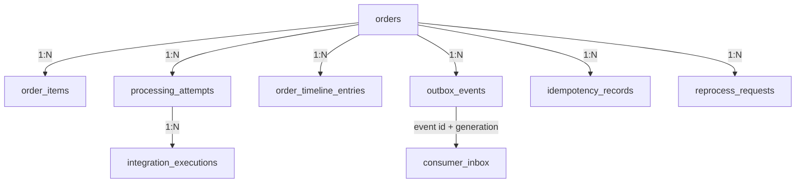
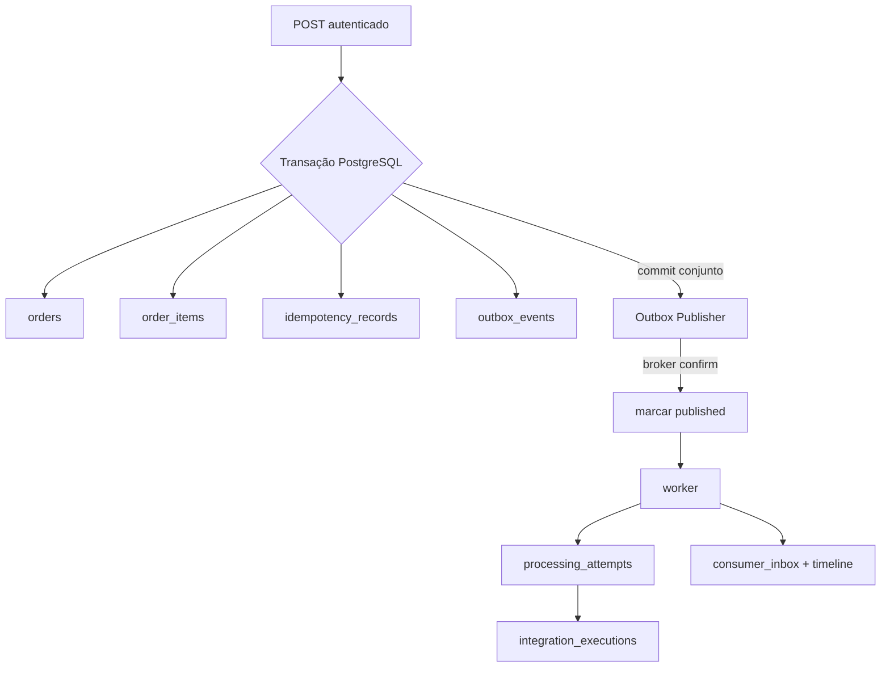

# FlowBridge — modelo de dados proposto

**Estado:** proposta da Fase 0, aguardando revisão.  
**Banco proposto:** PostgreSQL 18.6, conforme [ADR-005](../decisions/technology-stack.md).

O modelo protege regras importantes no banco porque duas requisições ou dois workers podem agir ao mesmo tempo. A aplicação valida para dar respostas úteis; constraints garantem que concorrência ou erro de programação não persistam estados inválidos. Tipos e tamanhos abaixo são propostas lógicas; migrations futuras decidirão tipos concretos após aprovação.

## Diagrama conceitual

`ORDER_TIMELINE_ENTRIES`, `REPROCESS_REQUESTS` e `CONSUMER_INBOX` são propostas para suportar histórico, auditoria e deduplicação. O guia exige seus comportamentos, mas não fixa nomes ou tabelas. `CONSUMER_INBOX` pode ser combinado com histórico se uma constraint equivalente garantir idempotência.

## Entidades e constraints

### `orders`

Representa o agregado do pedido e estado de negócio.

- `id`: UUID, PK.
- `external_reference`: texto limitado, nullable até definição do contrato.
- `status`: enum/text com CHECK para `RECEIVED`, `PROCESSING`, `COMPLETED`, `FAILED`.
- `currency`: código ISO 4217 de três letras (proposta a confirmar).
- `total`: decimal exato, não ponto flutuante; `CHECK total >= 0`.
- `processing_generation`: inteiro positivo iniciando em 1; aumenta em cada reprocessamento aprovado.
- `created_at`, `updated_at`: timestamps UTC.
- Constraint proposta: `UNIQUE(client_scope, external_reference)` somente se referência externa for confirmada como identificador único. Não incluir ainda sem decisão de ownership.
- Índices: `(status, created_at DESC)` para operação/listagem; `created_at DESC` para relatórios. Índices adicionais somente após filtros aceitos e plano de consulta.

### `order_items`

- `id`: UUID, PK; `order_id`: FK com `ON DELETE RESTRICT` ou cascade apenas se agregado for removido (retenção não definida; recomendação é não apagar pedidos).
- `line_number`: começa em 1, `UNIQUE(order_id, line_number)`.
- `sku`: não vazio e limitado; `description`: sintética/opcional conforme contrato.
- `quantity`: inteiro `> 0`; `unit_price`: decimal exato `>= 0`.
- Índice `(order_id, line_number)` apoia leitura ordenada; a constraint única cria índice correspondente.
- `orders.total` deve coincidir com soma de linhas. Não confiar em cálculo enviado pelo cliente; serviço calcula e testa.

### `idempotency_records`

Uma chave impede duplicar a criação se o cliente perdeu a resposta HTTP e repetiu a chamada.

- `client_scope`: identificador estável do cliente autenticado (por exemplo `client_id` validado); não usar access token bruto.
- `idempotency_key`: valor do header, tamanho e formato limitados.
- `request_hash`: hash de representação canônica dos campos materialmente relevantes do pedido; algoritmo e canonicalização documentados.
- `order_id`: FK ao pedido.
- `response_status` e `response_snapshot` (ou referência reconstruível) permitem repetir resultado original sem criar outro pedido.
- `created_at`, `expires_at` para expurgo após retenção acordada.
- Constraint obrigatória: `UNIQUE(client_scope, idempotency_key)`.
- Índice para expurgo em `expires_at`; leitura primária usa índice único.
- Mesma chave/hash: retornar o resultado original. Mesma chave/hash diferente: `409 Conflict`. Em concorrência, a constraint única é a árbitra; a aplicação captura colisão e lê registro vencedor.
- **Pendente:** duração de retenção proposta de 24 horas; confirmar se clientes podem repetir depois desse período.

### `outbox_events`

- `id`: UUID que também é `eventId`.
- `aggregate_id`: FK ao pedido; `event_type`, `event_version` fixam contrato.
- `payload`: JSONB validado pela versão do evento. Proposta: só `orderId` e geração, sem dados sensíveis.
- `status`: `PENDING`, `PUBLISHING` (claim/lease), `PUBLISHED`, `FAILED`/`DEAD` conforme política final.
- `publish_attempts`, `created_at`, `next_attempt_at`, `published_at`, `last_error_code`, `locked_until`/lease opcional.
- Índice parcial em `(next_attempt_at, created_at)` para linhas pendentes; índice `(aggregate_id, created_at)` para diagnóstico.
- Restrição `event_version > 0`, tentativas `>= 0`; `published_at` presente apenas quando estado `PUBLISHED`.
- O publicador deve evitar duas instâncias publicarem simultaneamente a mesma linha (`FOR UPDATE SKIP LOCKED`/claim transacional ou mecanismo equivalente). Não segurar transação de banco aberta durante uma chamada de rede longa.
- A janela “confirmou publish e caiu antes de atualizar Outbox” pode duplicar mensagem. Incluir stable event ID; consumidor deduplica.

### `processing_attempts` e `integration_executions`

`ProcessingAttempt` é uma execução do workflow para um pedido/generation; `IntegrationExecution` registra uma chamada individual de frete ou faturamento. Assim, “redelivery da mensagem” não é confundida com chamada de integração.

- `processing_attempts`: FK, `generation`, `attempt_number`, status (`RUNNING`, `SUCCEEDED`, `RETRYABLE_FAILURE`, `PERMANENT_FAILURE`), início/fim e código de erro seguro.
- Unique proposta `(order_id, generation, attempt_number)`; índice `(order_id, started_at)`.
- `integration_executions`: FK ao attempt, tipo (`FREIGHT`, `BILLING`), status, referência simulada, duração, error code, timestamps.
- Índices `(order_id, created_at)` e `(processing_attempt_id, integration_type)`.
- Uma chave idempotente de efeito por evento/generation/integração evita chamada simulada duplicada ao reentregar mensagem.
- Não gravar stack trace, token ou payload externo sensível no histórico operacional.

### `consumer_inbox`

Registra conclusão/estado do consumidor por identidade de evento, worker e geração.

- `event_id`: UUID do envelope; `consumer_name`; `generation`; status e `delivery_count`.
- Constraint proposta `UNIQUE(consumer_name, event_id, generation)`.
- Índices por estado e atualizado_em para localizar processamentos pendentes/estagnados.
- Não marcar definitivamente como processado antes de completar o efeito durável. Falhas transitórias deixam registro retomável; sucesso registra `COMPLETED`.
- Em chamadas externas simuladas, persistir também chave estável de operação no adaptador para que redelivery não repita efeito.

### `order_timeline_entries` e `reprocess_requests`

- Timeline é append-only para mudanças de estado, cada integração, retry, falha e reprocessamento.
- Evento da timeline contém categoria, texto curto, `safe_details` com allowlist, `occurred_at` e `correlation_id` (campo proposto).
- Índice `(order_id, occurred_at, id)` para timeline ordenada.
- Reprocess request registra quem pediu (`sub`/client ID validado), quando, motivo (proposta), geração criada e correlation ID.
- O dono deve decidir se `reason` é obrigatório; recomendação é obrigatório para ação operacional.
- Auditoria deve permitir reconstituição, não sobrescrever ou apagar entrada anterior.

## Relacionamentos e fluxo transacional

O Outbox elimina a janela de perda entre commit do pedido e tentativa de publicação; não pode fazer PostgreSQL e RabbitMQ confirmarem como uma só transação. Por isso a mensagem é pelo menos uma vez e os efeitos precisam ser idempotentes.

## Perguntas de esquema pendentes

1. `externalReference` é única por cliente? O guia não define isolamento/tenant; sem uma chave estável de cliente, consulta ampla por integração pode expor pedidos.
2. Quais dados mínimos determinam a resposta do frete simulado? Evitar endereço/PII se não necessário.
3. A retenção do projeto é append-only sem exclusão ou precisa de política de limpeza? Dados financeiros reais estão fora de escopo, mas DLQ e audit podem crescer.
4. O pedido pode ser apagado? Recomendação: não oferecer DELETE no escopo inicial para preservar histórico e integridade referencial.
5. Qual política de retenção da idempotência (sugestão: 24h) e da Outbox publicada?

## Como testar o modelo

- migrations criam banco vazio e evoluem sem alteração automática de schema pelo Hibernate;
- constraints rejeitam quantidade/preço inválidos e chave duplicada;
- cálculo de total é determinístico e usa decimal, não `float`/`double`;
- duas criações simultâneas com mesma chave resultam num pedido e uma resposta reusada;
- rollback remove pedido, itens, idempotência e Outbox juntos;
- publisher/worker repetidos não duplicam tentativas de negócio nem integração simulada;
- índices são confirmados com `EXPLAIN` nos filtros/paginação usados, sem criar índice preventivo para campos não consultados.
