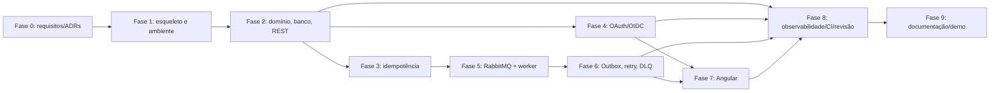

# FlowBridge — plano de desenvolvimento incremental

**Estado:** proposta da Fase 0. Nenhuma fase de implementação começa sem validação humana da fase anterior.

## Princípios de execução

- Uma entrega pequena por vez; escrever critérios e arquivos prováveis antes de alterar.
- Ensinar conceito novo, escrever teste primeiro para regra importante (RED), fazer menor implementação (GREEN), refatorar e executar novamente.
- Não usar mocks para afirmar que PostgreSQL, RabbitMQ, Keycloak ou Docker funcionam; usar integração real nos pontos indicados.
- Ao fim de cada entrega, apresentar diff, comandos/resultados, limites e perguntas de revisão. O proprietário valida critérios de fase antes de avançar.
- Guardar decisões aprovadas em ADR; se implementação revelar conflito, parar a mudança de arquitetura e apresentar alternativas.
- Este plano detalha o encadeamento do guia principal; não autoriza criar nada da Fase 1 agora.

## Dependências gerais

## Fase 0 — planejamento e decisões arquiteturais

### Entregas documentais

1. Requisitos funcionais/não funcionais rastreados ao guia.
2. Visão geral e diagramas de componentes/fluxos.
3. README inicial sem instruções de execução não validadas.
4. Módulos/fronteiras, modelo de domínio e modelo relacional com chaves, constraints e índices iniciais.
5. Endpoints e DTOs iniciais.
6. Envelope/topologia RabbitMQ e garantias de entrega.
7. Fluxos de criação, processamento, falha e reprocessamento.
8. ADRs para arquitetura, identidade, eventos/confiabilidade, dados/idempotência e stack.
9. Lista de ambiguidades com recomendação e decisões pendentes.

### Aceite da Fase 0

- Toda função do guia está representada ou explicitamente listada como futura/fora de escopo.
- Sugestões novas são marcadas como proposta; nenhuma vira requisito sem decisão do proprietário.
- Diagramas não contradizem tabelas de dados, contrato HTTP ou envelope de eventos.
- API e worker compartilham banco conforme proposta, sem sugerir chamada síncrona como transporte de processamento.
- A transação do pedido grava Outbox e idempotência juntas; documento admite redelivery e duplicidade.
- Respostas incluem códigos apropriados; segurança é aplicada no servidor.
- Stack é confrontada com versões oficiais correntes e riscos apontados.
- Proprietário aprova/rejeita decisões abertas e registra as escolhidas.

### Dependências

Nenhuma fase de código. A Fase 1 depende da aprovação do baseline da stack, hosting local do Keycloak e contratos mínimos de configuração. A Fase 2 depende do contrato do pedido e decisões de campo/status.

## Entregas curtas depois da aprovação da Fase 0

| Ordem | Entrega | Dependências | Critérios de aceite | Conceitos a ensinar |
|---|---|---|---|---|
| 1.1 | Validar versões e registrar stack pinada/ADR final | Aprovação do [ADR-005](../decisions/technology-stack.md) | Maven/Java/Node/Angular e imagens fixados; Angular e Node na matriz oficial; build tools compatíveis. | LTS, compatibilidade semântica, wrapper, tags imutáveis. |
| 1.2 | Definir pastas e build Maven multi-module para API/worker, sem regra de negócio | 1.1 | Maven Wrapper inicia; módulos compilam vazios; dependências não duplicadas; CI básico passa. | Maven project, modules, dependency management. |
| 1.3 | Criar app shells Spring Boot e health básico | 1.2 | API e worker iniciam separadamente; testes de contexto passam; nenhuma regra de pedido. | auto-config, bean, endpoint health. |
| 1.4 | Inicializar Angular CLI e estados mínimos | 1.1 | `npm ci`, build e teste estrutural passam com Node fixado; sem login/feature antes da fase correspondente. | CLI, SPA, package lock. |
| 1.5 | Docker Compose local de dependências (PostgreSQL, RabbitMQ, Keycloak) | ADR de hostname/config aprovado | `docker compose config`, health checks e persistência local funcionam; segredos fictícios locais e ignorados. | imagem/container, porta, volume, health check, rede. |
| 1.6 | CI estrutural | 1.2–1.5 | Workflow roda build e testes vazios; actions fixadas e permissões mínimas. | CI, workflow, artifacts e secrets. |

Cada subentrega recebe revisão humana antes da próxima; o guia principal agrupa-as dentro da Fase 1.

## Fase 2 — domínio, banco e REST

1. Criar teste de pedido válido e observar RED.
2. Testar dados inválidos, cálculo monetário e transições.
3. Implementar domínio mínimo; repetir GREEN/REFACTOR.
4. Criar migration e teste em PostgreSQL real.
5. Adicionar persistência, DTO, controller e Problem Details.
6. Adicionar paginação/filtros somente dos definidos.
7. Publicar OpenAPI e executar testes selecionados.

**Aceite:** API cria/lista/detalha; migrations constroem banco vazio; DTOs não expõem entidade; erros consistentes; testes unidade+integração passam. OAuth, RabbitMQ, Outbox e UI ainda não entram nessa fase.

**Dependência:** decidir campos do pedido e `externalReference`. Se frete exige dados ausentes, cliente precisa resolver a questão antes da implementação desse contrato.

## Fase 3 — idempotência

Testar chamada inicial, repetição equivalente, payload conflitante, chamadas concorrentes e restart. Implementar chave persistida com unique constraint, hash canônico, replay de resposta e política de retenção.

**Aceite:** sem duplicidade sob concorrência; `409` para payload diferente; persistência além de processo; retenção documentada; PostgreSQL real no teste concorrente.

**Dependência:** decisão de scope da chave (client/user/tenant) e duração de retenção.

## Fase 4 — OAuth/OIDC/Keycloak

Ensinar conceitos; configurar realm/client local; SPA Authorization Code + PKCE; API Resource Server JWT; testar mapping explícito e `401/403/permitido`; configurar client credentials.

**Aceite:** issuer, audience, assinatura e timestamps validados; role de usuário não é inferida de client machine; secrets fora do Git; origem/redirect local explícitos.

**Dependência:** hostname/issuer canônico e decisão de armazenamento do token em SPA.

## Fase 5 — RabbitMQ e worker

Definir contrato `OrderSubmitted.v1`; configurar exchange/fila; primeira publicação demonstrativa; consumo independente; atualização de estado; adaptadores de freight/billing simulados; testes de broker real.

**Aceite:** API retorna antes do processamento final; evento chega ao worker; correlation ID existe; redelivery não duplica efeitos; teste real de broker passa. Nesta entrega publicar inicialmente sem Outbox conforme sequência do guia; documentar a janela de perda.

**Dependência:** contratos aprovados e serviços locais funcionais.

## Fase 6 — Outbox, retries, DLQ e reprocessamento

Adicionar Outbox transacional; publisher recuperável; consumer idempotente; classificar erros; retry/backoff limitado; DLQ; ação autorizada/auditada; testar falhas antes/depois do publish/side effect/ACK.

**Aceite:** pedido sem perda de evento após falha; eventual duplicidade não duplica efeito; retry encerra no limite; DLQ inspecionável; reprocessamento conserva história; garantias reais documentadas (sem exactly-once).

**Dependência:** topologia e parâmetros de retry aprovados; registrar como RabbitMQ e banco reconciliam estado final.

## Fase 7 — Angular

Implementar tela por contratos REST existentes: login, dashboard, listagem/detalhe/timeline, integrações, falhas/reprocessamento. Ensinar componente/serviço/router/form/HttpClient/OIDC e testar cada fatia.

**Aceite:** dados vêm da API; UI tem loading/error/empty/success, acessibilidade básica; OIDC usa PKCE; guard de rota não substitui backend; teste unitário e E2E principal passam.

**Dependências:** contratos backend estáveis e Fase 4; operações de falha precisam da Fase 6.

## Fase 8 — observabilidade, CI e revisão

Adicionar logs estruturados/correlation ID, métricas básicas, relatório de cobertura, integrações CI e revisar segurança/performance/dependências.

**Aceite:** pedido rastreável em logs, sem secrets; CI barra falha; cobertura em domínio/casos de uso orienta lacunas (meta inicial ~80%, não métrica de qualidade isolada); limitações registradas.

**Dependência:** caminhos principais implementados nas fases 2–7.

## Fase 9 — README/demo/portfólio

README conforme guia; exemplos de API; instruções de configuração local sem segredos; screenshots sintéticas; vídeo; clone limpo.

**Aceite:** fluxo completo reproduzível por terceiros, documentação coerente, claims no portfólio verificáveis e proprietário explica fluxo/limites.

## Portão de aprovação humana

Esta entrega não solicita aprovação para executar código agora. A Fase 0 só será considerada validada quando o proprietário revisar os documentos e resolver ou aceitar explicitamente os pontos marcados como pendentes. A próxima tarefa sugerida, após aprovação, é fechar o ADR-005 e as ambiguidades do pedido/retry/issuer; então iniciar somente a entrega 1.1. Não executar a Fase 1 automaticamente.
