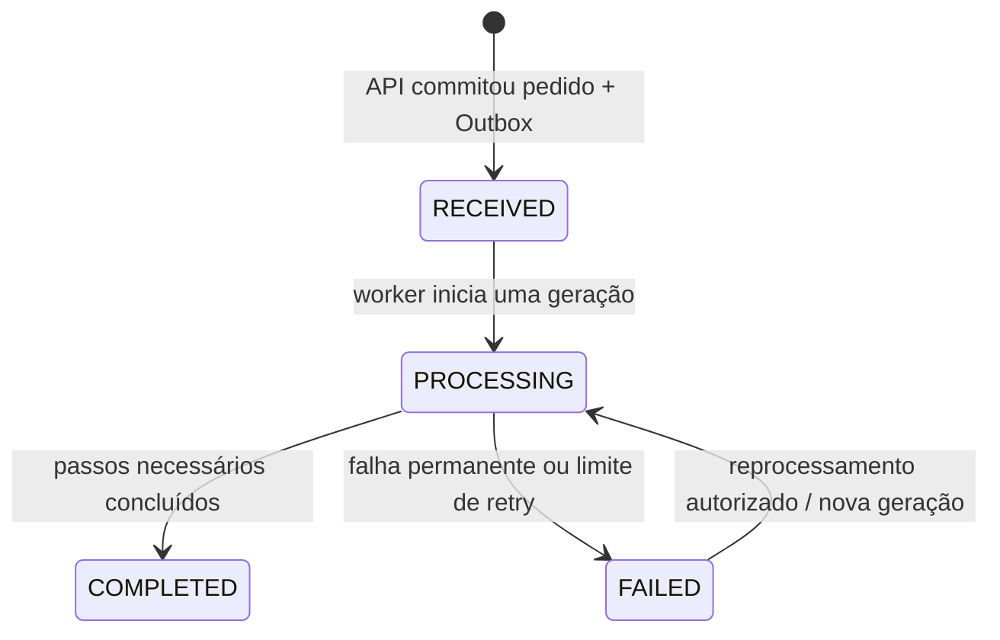

# FlowBridge — modelo de domínio

**Estado:** modelo conceitual aprovado na Fase 0; implementação ainda não iniciada.

## Conceitos do domínio

- **Order:** pedido aceito pela API e unidade principal de consulta. Possui estado global e itens.
- **Integration client:** identidade `client_id` que criou o pedido e delimita todo acesso de máquina.
- **OrderItem:** linha do pedido com SKU, quantidade e preço unitário; total é derivado e usa decimal exato.
- **Processing generation:** rodada completa de processamento. A primeira começa em 1; reprocessamento autorizado cria outra geração, sem apagar a anterior.
- **Processing attempt:** execução de uma rodada pelo worker. Uma redelivery pode criar uma tentativa nova, mas não deve repetir uma integração já concluída.
- **Integration execution:** chamada individual ao adaptador de frete ou faturamento com resultado, duração e falha.
- **Integration type:** identificador estável do tipo lógico do adaptador (`FREIGHT` ou `BILLING`); não há entidade de integração configurável no modelo atual.
- **Processing step:** etapa nomeada e versionada dentro de uma geração, com estado, hash de entradas e dependências explícitas.
- **Outbox event:** intenção persistida de publicar evento após commit do pedido.
- **Integration type:** enum lógico `FREIGHT` ou `BILLING` que identifica qual adaptador executou uma chamada; não existe entidade configurável de integração neste modelo.
- **Idempotency record:** associação durável de chave do cliente, hash do pedido enviado e resposta/recurso criado.
- **Reprocess request:** ação operacional autorizada e auditável que inicia nova geração.

## Estados do pedido

O status do pedido é uma projeção do fluxo global, não a cópia do último status de uma integração. Frete pode concluir e faturamento falhar; a regra do status geral precisa refletir os requisitos de negócio e ser testada.

## Invariantes propostas

1. Pedido válido contém ao menos um item; quantity > 0 e unit price >= 0.
2. O total do pedido é calculado a partir das linhas no backend e não é confiado ao cliente.
3. `RECEIVED` só existe após o commit conjunto de pedido, itens, chave de idempotência e Outbox.
4. Só transições documentadas são válidas; worker não muda `FAILED` para `PROCESSING` sem ação autorizada e nova geração.
5. Cada etapa e falha gera histórico; reprocessar não apaga evidência anterior.
6. Repetir uma criação com mesma chave e mesmo conteúdo retorna o recurso anterior; mesma chave com conteúdo diferente conflita.
7. Reentrega de evento não pode duplicar efeito de negócio. Chaves de deduplicação devem identificar evento, consumidor, geração e integração relevante.
8. Uma resposta HTTP de criação não significa que freight/billing terminaram; `RECEIVED`/`PROCESSING` comunica consistência eventual.

## Etapas e dependências do processamento

As etapas iniciais são `FREIGHT` e `BILLING`, mas a especificação não determina se há dependência entre elas. Na Fase 6, o grafo acíclico e versionado declarará explicitamente cada aresta; ordem de execução não implica dependência. `COMPLETED` exige todas as etapas obrigatórias válidas. Cada etapa guarda versão da regra e hash das entradas. Ao reprocessar, o sistema começa na etapa falha e seleciona seus descendentes; preserva etapa concluída apenas se resultado, versão/hash e pré-requisitos ainda forem válidos. Caso contrário, refaz a etapa e descendentes. A escolha das arestas será registrada e testada antes do workflow executável.

## Decisões registradas e limites

- Frete usa zonas sintéticas de origem/destino e peso total em gramas; endereço real não é coletado.
- A representação OpenAPI da moeda, limites técnicos e lista de zonas permitidas será consolidada antes de concluir os schemas de entrada; nenhuma regra adicional de negócio está aprovada.
- O comportamento exato dos adaptadores para dados inválidos será definido na implementação de cada adaptador, respeitando os campos e validações do contrato aprovado.
- Reprocessamento exige motivo e nova geração/evento; histórico anterior é preservado.
- Uma etapa permanente falha deixa pedido global `FAILED`, com estado individual por etapa/integração.
- `externalReference` continua opcional e sem unicidade aprovada. Retenção de timeline/Outbox publicada/DLQ e alterações manuais do pedido permanecem fora do contrato inicial.

O modelo relacional, constraints e índices ficam em [data-model.md](data-model.md); as mensagens ficam em [event-contracts.md](event-contracts.md).
