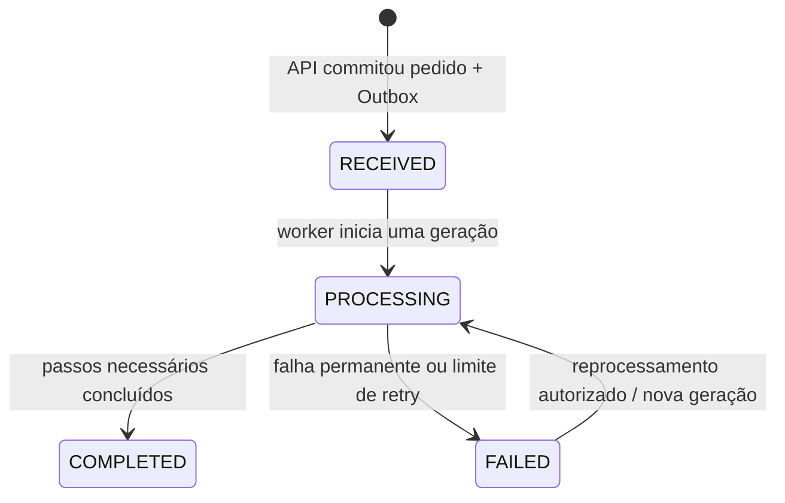

# FlowBridge — modelo de domínio

**Estado:** proposta da Fase 0, alinhada à visão do guia principal.

## Conceitos do domínio

- **Order:** pedido aceito pela API e unidade principal de consulta. Possui estado global e itens.
- **OrderItem:** linha do pedido com SKU, quantidade e preço unitário; total é derivado e usa decimal exato.
- **Processing generation:** rodada completa de processamento. A primeira começa em 1; reprocessamento autorizado cria outra geração, sem apagar a anterior.
- **Processing attempt:** execução de uma rodada pelo worker. Uma redelivery pode criar uma tentativa nova, mas não deve repetir uma integração já concluída.
- **Integration execution:** chamada individual ao adaptador de frete ou faturamento com resultado, duração e falha.
- **Outbox event:** intenção persistida de publicar evento após commit do pedido.
- **Idempotency record:** associação durável de chave do cliente, hash do pedido enviado e resposta/recurso criado.
- **Reprocess request:** ação operacional autorizada e auditável que inicia nova geração.

## Estados do pedido

O status do pedido é uma projeção do fluxo global, não a cópia do último status de uma integração. Frete pode concluir e faturamento falhar; a regra do status geral precisa refletir os requisitos de negócio e ser testada.

## Invariantes propostas

1. Pedido válido contém ao menos um item; quantity > 0 e unit price >= 0.
2. O total do pedido é calculado a partir das linhas no backend e não é confiado ao cliente.
3. `RECEIVED` só existe após o commit conjunto de pedido, itens, chave de idempotência e Outbox.
4. Só transições documentadas são válidas; worker não muda `FAILED` para `PROCESSING` sem ação autorizada e nova geração.
5. Cada etapa e falha gera histórico; reprocessar não apaga evidência anterior.
6. Repetir uma criação com mesma chave e mesmo conteúdo retorna o recurso anterior; mesma chave com conteúdo diferente conflita.
7. Reentrega de evento não pode duplicar efeito de negócio. Chaves de deduplicação devem identificar evento, consumidor, geração e integração relevante.
8. Uma resposta HTTP de criação não significa que freight/billing terminaram; `RECEIVED`/`PROCESSING` comunica consistência eventual.

## Sequência proposta de processamento

O guia não especifica se frete e faturamento são sequenciais ou paralelos. Para primeira versão didática, recomenda-se executar em sequência (frete e depois faturamento), com gravação de cada execução. Isso torna falhas parciais e reprocessamento mais fáceis de explicar, mas pode ser alterado apenas após decisão. O status `COMPLETED` exige todas as etapas obrigatórias; essa lista deve ser confirmada.

## Questões de negócio abertas

- Quais campos mínimos permitem simular frete? Endereço é desnecessário até ser explicitamente justificado.
- Moeda é uma por pedido? A proposta é uma moeda comum para todas as linhas, sem conversão cambial.
- Qual etapa falha se a quantidade/SKU for reconhecida como inválida pelo adaptador simulado?
- Reprocessamento repete todas as integrações ou apenas a falha? Recomendação inicial: fluxo completo com dedupe por etapa já concluída, a confirmar.
- Qual status manter se uma etapa termina e outra é permanentemente falha? Recomendação: `FAILED` global e status individual por integração.

O modelo relacional, constraints e índices ficam em [data-model.md](data-model.md); as mensagens ficam em [event-contracts.md](event-contracts.md).
