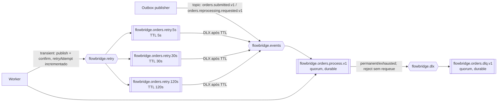

# FlowBridge — contratos de eventos RabbitMQ

**Estado:** proposta da Fase 0, aguardando revisão.  
**Objetivo:** comunicação assíncrona durável entre API/publicador e worker, mantendo os eventos pequenos e sem dados sensíveis.

## Envelope versionado

O mesmo envelope se aplica às versões de eventos. Campos padrão:

| Campo | Tipo | Significado |
|---|---|---|
| `eventId` | UUID | Identidade estável da ocorrência. Duplicatas de transporte preservam este ID; um reprocessamento cria novo event ID. |
| `eventType` | string | Nome semântico, por exemplo `OrderSubmitted`. |
| `eventVersion` | inteiro positivo | Versão incompatível do schema de payload. |
| `occurredAt` | timestamp UTC | Hora em que a solicitação foi gravada. |
| `correlationId` | UUID/texto limitado | Liga logs e requisições relacionadas. |
| `aggregateId` | UUID | ID do pedido relacionado. |
| `processingGeneration` | inteiro positivo | Geração do workflow; começa em 1 e aumenta em reprocessamento autorizado. |
| `payload` | objeto JSON | Dados mínimos do evento. |

### `OrderSubmitted.v1`

```json
{
  "eventId": "8ca5fead-3e7f-4a4c-9353-b028a6f0b2d2",
  "eventType": "OrderSubmitted",
  "eventVersion": 1,
  "occurredAt": "2026-11-01T12:00:00Z",
  "correlationId": "2a035347-84ed-4ebf-ae19-68a801fb383c",
  "aggregateId": "440f14b7-a55b-4935-9719-0dd71ef67140",
  "processingGeneration": 1,
  "payload": { "orderId": "440f14b7-a55b-4935-9719-0dd71ef67140" }
}
```

O worker busca os itens no PostgreSQL pelo `orderId`, conforme a arquitetura proposta de banco compartilhado. Não enviar pedido completo no broker: reduz dados replicados e exige que banco e worker respeitem compatibilidade de schema. Payload mínimo ainda precisa de campos extras caso o adaptador de frete os exija; isso é uma pendência explícita.

### `OrderReprocessingRequested.v1`

Usado para reprocessamento autorizado. Possui o mesmo envelope e `payload.orderId`, `processingGeneration` incrementada e `eventId` novo. O ator/motivo fica na tabela de auditoria; não é necessário copiá-los para o evento, exceto se a implementação identificar necessidade operacional.

### Evolução

- Mudança aditiva compatível pode ficar na mesma versão se consumidores ignorarem campos desconhecidos e o schema permitir.
- Remover/renomear campo, mudar tipo/semântica ou tornar campo obrigatório requer `eventVersion` nova, routing key nova e período de migração documentado.
- `eventType`, `eventVersion`, routing key e header AMQP `type`/`message_id` devem concordar; validar ao consumir.
- JSON é a serialização proposta. Schema registry está fora de escopo inicial; versionar exemplos/JSON Schema no repositório é sugestão para implementação.

## Topologia proposta



### Exchanges, filas e routing keys

| Nome proposto | Tipo/durabilidade | Routing/binding | Propósito |
|---|---|---|---|
| `flowbridge.events` | topic, durable | `orders.submitted.v1`, `orders.reprocessing.requested.v1` | Exchange de eventos do domínio. |
| `flowbridge.orders.process.v1` | quorum, durable | Bind às duas routing keys acima | Fila principal do worker. |
| `flowbridge.retry` | direct, durable | `orders.retry.5s`, `.30s`, `.120s` | Recebe republicações atrasadas após falha transitória. |
| `flowbridge.orders.retry.5s` / `.30s` / `.120s` | quorum durable, message TTL proposto 5s/30s/120s | dead-letter exchange `flowbridge.events`, routing key original | Aguarda antes de retornar ao trabalho. |
| `flowbridge.dlx` | direct, durable | `orders.failed.v1` | Exchange de dead lettering terminal. |
| `flowbridge.orders.dlq.v1` | quorum, durable | binding `orders.failed.v1` | Mensagens que esgotaram retry ou não podem ser processadas; investigação manual/auditável. |

Todos os valores acima são sugestões explícitas, não requisitos já aprovados. Configurar filas/exchanges por policy declarativa versionada; não depender de criação manual em painel. Evitar `requeue=true` imediato como política de retry.

### Propriedades AMQP

- mensagem persistente (`deliveryMode=2`) e filas duráveis;
- `message_id = eventId`, `correlation_id = correlationId`, `type = eventType + ".v" + eventVersion`, content type JSON;
- headers `processing-generation` e `retry-attempt` (inteiro). `retry-attempt=0` na primeira entrega;
- publisher confirms habilitados e retorno de mensagem não roteada tratado como falha, não como sucesso;
- consumer ACK manual após efeitos persistidos; prefetch explícito para limitar trabalho em voo;
- queue delivery limit explícito mesmo que RabbitMQ tenha default, pois configuração default pode variar entre versão/topologia;
- proposal de quorum + at-least-once dead-lettering exige verificar policy/overflow aceitos pela versão. RabbitMQ documenta trade-offs: pode reter mensagens, aumentar uso de recursos e ainda exigir deduplicação.

## Retry, falhas e DLQ

1. O worker classifica erro como transitório ou permanente; classificação é explícita e testável.
2. Em falha transitória, registra `ProcessingAttempt` e o código de erro. Se ainda há tentativas, republica mensagem para fila de atraso correspondente com `retry-attempt + 1`, aguarda publisher confirm e só então ACKa a entrega atual.
3. Se a publicação da cópia de retry não for confirmada, não ACKar a original; proteger contra loop agressivo com contagem de delivery/restart e alarmes. Melhor robustez futura pode persistir intenção de retry no Outbox, mas isso eleva escopo; decidir antes se cenário exigir.
4. Após 3 redeliveries propostas (4 execuções totais) e delays 5s/30s/120s, marcar pedido `FAILED`, registrar timeline e rejeitar sem requeue para DLX/DLQ.
5. Erro permanente segue para DLQ sem repetir automaticamente; pedido fica `FAILED` com código de falha não sensível.
6. Falha no processo antes de ACK provoca redelivery. `eventId` e `processingGeneration` mantêm idempotência; uma tentativa em estado incompleto pode ser retomada sem repetir integração já concluída.
7. Operação humana investiga DLQ. Reprocessamento pelo endpoint cria registro de auditoria e evento/generation novos; não apagar a mensagem ou histórico original silenciosamente.

**Parâmetros ainda sujeitos à aprovação:** contagem total, atrasos, jitter, TTL, política de poison message, retenção da DLQ e se intenção de retry também precisa ser persistida em Outbox. RabbitMQ não oferece `exactly-once`; a garantia proposta é processamento pelo menos uma vez com efeitos idempotentes.

## Como testar

- contrato JSON e campos obrigatórios inválidos/versões desconhecidas;
- publisher confirma mensagem persistente roteada e detecta mensagem sem binding;
- consumer muda status e ACK somente após commit;
- queda antes de integração, após integração e antes do ACK;
- duplicate delivery não duplica cobrança/faturamento simulado;
- transiente passa pelas filas de atraso e respeita limite;
- permanente/esgotada chega à DLQ, preservando estado/timeline;
- indisponibilidade de fila de retry não perde silenciosamente a mensagem;
- teste de contrato demonstra que evento antigo não é reinterpretado como versão nova.

RabbitMQ real via Testcontainers é necessário para declarar exchange, TTL, DLX, confirmações e ACK validados. Mocks servem só para classificação de erro e regra pura de retry.

## Fontes

- [RabbitMQ releases](https://www.rabbitmq.com/release-information)
- [Quorum queues e delivery limit](https://www.rabbitmq.com/docs/quorum-queues)
- [Dead-letter exchanges](https://www.rabbitmq.com/docs/dlx)
- [Publisher confirms](https://www.rabbitmq.com/docs/confirms)
- [Message TTL](https://www.rabbitmq.com/docs/ttl)
