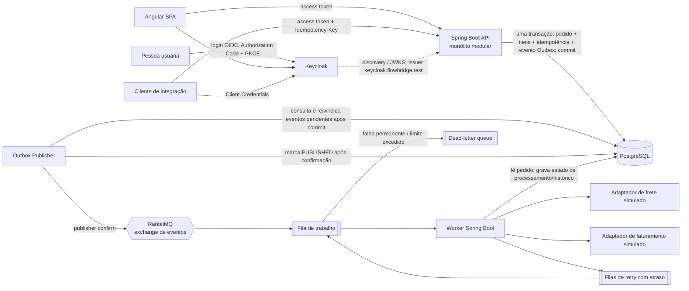

# FlowBridge — visão geral da arquitetura

**Estado:** arquitetura aprovada na Fase 0; implementação ainda não iniciada
**Referência funcional:** [`FLOWBRIDGE_GUIA_DE_DESENVOLVIMENTO_CLAUDE_CODE_REENVIO.md`](../../FLOWBRIDGE_GUIA_DE_DESENVOLVIMENTO_CLAUDE_CODE_REENVIO.md)  
**Data de verificação da stack:** 1 nov. 2026

Este documento consolida as decisões aprovadas pelo proprietário na Fase 0. Detalhes ainda não decididos aparecem como limites explícitos; esta documentação não altera a especificação principal nem inicia implementação.

## Resumo

- **Frontend:** SPA Angular. Usa OpenID Connect para autenticar pessoas no Keycloak e envia access tokens à API.
- **API:** aplicação Spring Boot organizada como monólito modular. Recebe pedidos, aplica validações e idempotência, grava dados transacionais e expõe consultas e ações autorizadas.
- **Persistência:** PostgreSQL é a fonte de verdade para pedidos, estado, histórico, Outbox e idempotência.
- **Mensageria:** RabbitMQ transporta eventos duráveis do Outbox Publisher independente ao worker.
- **Worker:** processo Spring Boot separado que lê eventos, executa adaptadores simulados de frete e faturamento e registra resultados no PostgreSQL.
- **Identidade:** Keycloak emite tokens OIDC/OAuth 2.0; a API valida e autoriza cada operação. A SPA não é a autoridade de segurança.

O monólito modular mantém as capacidades de negócio separadas dentro da API. O worker é um processo separado porque o consumo assíncrono tem ciclo de vida e escala independentes. Ambos compartilham o PostgreSQL nesta versão educacional; isso evita introduzir uma segunda persistência, mas requer limites explícitos de acesso e coordenação de migrations.

## Contexto e componentes



### O que cada comunicação significa

1. **Navegador ↔ Keycloak:** OIDC autentica a pessoa. A SPA é cliente público e usa PKCE; não guarda segredo de cliente.
2. **Navegador/cliente ↔ API:** o bearer access token identifica o principal e suas permissões. O backend valida localmente assinatura, `iss`, validade e `aud` usando metadados/chaves públicas descobertos no issuer (com cache/rotação); verifica autorização no endpoint. Não chama o Keycloak em cada requisição.
3. **API ↔ PostgreSQL:** uma transação grava pedido, itens, registro da chave de idempotência e evento Outbox juntos. Se a transação falhar, nenhum desses elementos deve ser confirmado parcialmente.
4. **Outbox Publisher ↔ PostgreSQL/RabbitMQ:** a API não chama o publisher. Após o commit da transação de pedido e Outbox, o processo independente consulta/reivindica linhas pendentes na tabela Outbox com claim atômico e lease recuperável, publica no RabbitMQ e, após confirmação e roteamento observado, atualiza a linha sob o claim vigente. Se cair entre confirmação e marcação no banco, pode publicar novamente com o mesmo `eventId`.
5. **RabbitMQ ↔ worker:** o broker entrega pelo menos uma vez segundo a configuração e o worker confirma (ACK) depois de gravar o resultado durável. Autenticação da conexão limita acesso ao broker, mas não valida o conteúdo: worker aplica allowlist de origem/routing key, valida schema/versão/propriedades/IDs e deduplica antes de executar efeitos. Entrega repetida precisa ser segura.
6. **Worker ↔ PostgreSQL/adaptadores:** o worker muda o estado, registra tentativas e chama adaptadores simulados. A gravação no banco e o efeito de uma chamada externa não formam uma transação distribuída; a idempotência do adaptador é necessária.

### Conceitos para aprender

- **Monólito modular:** uma aplicação implantável que mantém módulos de negócio com limites internos claros. Evita o custo operacional de vários serviços sem abandonar separação de responsabilidades.
- **Worker:** processo que consome trabalho fora do ciclo de uma requisição HTTP. A API responde que o pedido foi recebido; não espera frete e faturamento terminarem.
- **Broker e fila:** RabbitMQ aceita e encaminha mensagens para consumidores. O broker desacopla o tempo da API do tempo do worker, mas cria duplicidade, atraso e operação de falhas que precisam ser projetados.
- **Consistência eventual:** logo após a resposta HTTP, o pedido pode ainda estar `RECEIVED`; mais tarde converge para `COMPLETED` ou `FAILED`.
- **Outbox:** salva a intenção de publicar na mesma transação do pedido. Um processo separado publica depois; não cria uma transação única entre PostgreSQL e RabbitMQ.

## Responsabilidades dos módulos

| Área | Responsabilidades e limites |
|---|---|
| `orders` | DTOs e endpoints de pedidos, regras de criação/consulta, entidades e estados do pedido. Não executa chamadas HTTP de integração dentro do controller. |
| `processing` | Orquestra etapas, registra tentativas, aplica transições globais e coordena o tratamento de falhas. As regras de transição devem ser testáveis sem RabbitMQ. |
| `integrations` | Contratos e adaptadores simulados para frete e faturamento; captura resultado, duração e erro. Não deve decidir permissões de usuário. |
| `outbox` | API grava o evento transacional; um Outbox Publisher independente consulta/reivindica eventos pendentes após commit, publica com confirmação e registra o resultado. O endpoint HTTP não chama o publicador. |
| `identity` | Mapeia claims, roles e scopes externos a authorities internas se esse código for necessário. Não implementa emissão, senha ou assinatura de tokens. |
| `shared` | Somente elementos realmente transversais, como formato comum de erro, correlation ID e observabilidade. Evitar um depósito de classes sem dono. |
| Worker `messaging` | Declara/configura consumo, desserializa e valida envelope, controla ACK/NACK e encaminha o caso de uso. |
| Worker `processing` | Executa o fluxo de uma mensagem, registra tentativas e aplica idempotência por evento/geração. |
| Worker `integrations` | Usa os mesmos contratos conceituais de integração; não deve duplicar regras de domínio da API. |

### Acesso compartilhado ao PostgreSQL

API e worker não chamam classes internas uma da outra: cooperam por evento versionado, banco compartilhado e regras de domínio documentadas. O banco/schema é compartilhado, mas as credenciais são distintas. Um usuário dedicado aplica migrations; API e worker não têm DDL nem superuser. API grava pedido, itens, idempotência, Outbox e solicitações de reprocessamento; worker lê pedido/itens e grava tentativas, execuções, inbox, timeline e estado de processamento. Grants por tabela/operação e, quando adequado, por coluna são mínimos. A tabela de permissões fica no [ADR-001](../decisions/ADR-001-modular-monolith-and-worker.md); sua configuração é trabalho futuro da Fase 1.

### Identidade e isolamento

O hostname/issuer local é `http://keycloak.flowbridge.test:8080/realms/flowbridge`. O host resolve o domínio para `127.0.0.1`; a rede Docker usa o mesmo nome como alias do Keycloak. Navegador e API precisam obter o mesmo issuer; a API valida tokens. O worker não recebe tokens de usuário/client nem valida tokens OIDC: consome mensagens da infraestrutura RabbitMQ autenticada e usa controles próprios de envelope, deduplicação, estado e permissões restritas no PostgreSQL. Nomes DNS internos alternativos não podem aparecer no `iss`. Todos os pedidos de integração são escopados por `client_id`, também em leituras individuais por UUID. Pessoas com permissões operacionais têm acesso de acordo com suas roles; clients máquina não recebem acesso administrativo nem reprocessam.

### Reprocessamento por dependência

O worker mantém grafo explícito e versionado de etapas. Os nós iniciais são `FREIGHT` e `BILLING`; a especificação não determina se há aresta de dependência entre eles. Cada etapa registra estado, versão da regra e hash das entradas. Um reprocessamento inicia na etapa falha e inclui seus descendentes no grafo declarado; resultado bem-sucedido só é preservado quando regra, entradas e pré-requisitos continuam válidos. Uma etapa invalidada invalida seus descendentes. O motivo e ator ficam em auditoria, o evento recebe nova geração e ID, e os resultados anteriores não são apagados.

## Fluxo de pedido

```mermaid
sequenceDiagram
  participant C as Cliente
  participant K as Keycloak
  participant A as API
  participant D as PostgreSQL
  participant P as Publicador Outbox
  participant R as RabbitMQ
  participant W as Worker
  participant I as Adaptadores simulados
  C->>K: obtém access token
  C->>A: POST /orders + token + Idempotency-Key
  Note over A: valida localmente assinatura, issuer, audience e claims com JWKS/configuração Resource Server
  A->>D: transação Order + Items + IdempotencyRecord + OutboxEvent
  D-->>A: commit
  A-->>C: 201 Created + Location + estado RECEIVED
  P->>D: consulta/reivindica Outbox pendente após commit
  P->>R: publica OrderSubmitted.v1 (persistente)
  R-->>P: publisher confirm
  P->>D: marca evento publicado após confirm
  R->>W: entrega mensagem
  W->>D: inicia tentativa; RECEIVED → PROCESSING
  W->>I: consulta frete e solicita faturamento
  I-->>W: resultados simulados
  W->>D: grava execuções e estado final
  W-->>R: ACK após persistência
```

Para reprocessamento autorizado, a API valida role humana e pedido `FAILED`, exige motivo e grava uma requisição auditável com geração nova junto do evento Outbox; o Publisher envia esse evento após commit. Worker calcula as etapas a refazer pela relação de dependências e preserva os resultados ainda válidos.

Se uma integração falhar temporariamente, o worker registra a tentativa e agenda uma entrega atrasada limitada. Se falhar permanentemente ou esgotar tentativas, registra `FAILED` e a mensagem segue para DLQ conforme a topologia escolhida. Um operador autorizado solicita reprocessamento; a API registra a ação e publica uma nova geração do processamento. A história antiga permanece.

## Estratégia de qualidade e testes

O plano de testes completo está no guia principal; esta arquitetura exige a seguinte divisão:

- regras de domínio e transições: teste unitário sem dependências externas;
- caso de uso de criação e erros de contrato HTTP: teste de API;
- migrations, índices, constraints e idempotência concorrente: PostgreSQL real via Testcontainers;
- exchange, binding, publisher confirms, ACK, retry e DLQ: RabbitMQ real via Testcontainers;
- autorização: casos `401`, `403`, token válido, issuer/audience inválidos e separação usuário/cliente;
- fluxo integrado de demonstração: teste E2E selecionado depois da UI.

Mocks podem isolar uma unidade, mas não provam que SQL, migrações, bindings ou a configuração do Keycloak funcionam.

## Compatibilidade de versões verificada

Referências oficiais consultadas em **1 nov. 2026**. O patch indicado é a versão estável atual observada, não uma ordem para acompanhar patches sem avaliação. Antes de iniciar a Fase 1, conferir novamente e fixar versões exatas de dependências, plugins e imagens.

| Componente | Recomendação de base | Situação e compatibilidade | Alternativa / cuidado |
|---|---|---|---|
| Java | JDK 21 LTS | Versão aprovada pelo proprietário; Spring Boot 4.1.2 aceita Java 17–27. | Validar starters/plugins na Fase 1; Java 25 não faz parte do baseline aprovado. |
| Spring Boot | 4.1.2 estável | Versão aprovada; compatível com Java 21 e Maven 3.x. | Troca para linha 3.5 só com evidência de incompatibilidade e aprovação registrada. |
| Maven | Maven Wrapper 3.10.0 | Versão estável recomendada pelo Apache em 1 nov. 2026; wrapper torna o build reprodutível. | Manter 3.9.16 se um plugin essencial falhar em 3.10; Maven 4 ainda RC, não usar como base. |
| Angular | 22.x | Angular 22 está em suporte ativo na página oficial consultada. | Angular 21 está em LTS, útil como alternativa mais madura, mas tem menos tempo de suporte restante. |
| Node.js | 24.22.2 LTS | Angular 22 aceita Node `^24.15.0`; Node 24 está em LTS. | Node 26 também é LTS e aparece na matriz Angular 22, mas Node 24 tem mais tempo de maturidade de ecossistema. Fixar patch via arquivo de versão. |
| TypeScript | 6.0.x compatível com Angular 22 | Matriz Angular 22: `>=6.0.0 <6.1.0`. Deixar o Angular CLI gerir a versão compatível. | Não atualizar TypeScript isoladamente fora da faixa suportada. |
| PostgreSQL | 18.6 | PostgreSQL 18 é a versão major atual, com suporte publicado até nov. 2030; 18.6 é o minor atual consultado. | Não usar 19 Beta/RC como base. PostgreSQL 17.11 é alternativa suportada se driver/migration/test tooling mostrar incompatibilidade. |
| RabbitMQ | 4.4.0 (linha 4.4.x) | Release oficial 4.4.0 em 20 out. 2026; suporte comunitário previsto até jul. 2027. Usar imagem explícita com management. | É release muito recente; validar plugin Spring AMQP e Testcontainers. Se instabilidade aparecer, 4.3.6 ainda recebe suporte comunitário até jan. 2027, portanto a janela é curta. |
| Keycloak | 26.8.1 (linha 26.8.x) | Patch anunciado oficialmente em 13 out. 2026. Fluxos necessários são padrões OIDC/OAuth 2.0. | Fixar patch e reler migration/release notes em upgrades; não depender de formato de claims implícito. |

**Decisão registrada:** baseline aprovado no [ADR-005](../decisions/technology-stack.md). Fixar tags/pins concretos e executar prova de compatibilidade na Fase 1. Riscos principais: Spring Boot 4, Angular/TypeScript 6 e novidade operacional RabbitMQ 4.4. Não flexibilizar pins para `latest`.

## Limites e questões remanescentes

- `externalReference` permanece opcional e sem unicidade aprovada.
- Retenção operacional de Outbox publicada, timeline e DLQ, rate limiting, SLA e backup produtivo ainda não estão definidos.
- Topologia concreta de filas TTL/quorum e proteção de retry publish-confirm/ACK será provada na Fase 6.
- A conectividade do issuer local, as permissões SQL e as versões de patch só serão validadas quando o ambiente existir na Fase 1.

## Fontes oficiais

- [Spring Boot releases e documentação estável](https://docs.spring.io/spring-boot/)
- [Spring Boot 4.1 system requirements](https://docs.spring.io/spring-boot/system-requirements.html)
- [Spring Boot 3.5 system requirements](https://docs.spring.io/spring-boot/3.5/system-requirements.html)
- [Java SE support roadmap](https://www.oracle.com/java/technologies/java-se-support-roadmap.html)
- [Angular version compatibility](https://angular.dev/reference/versions) e [releases/support](https://angular.dev/reference/releases)
- [Node.js releases](https://nodejs.org/en/about/previous-releases)
- [Maven releases history](https://maven.apache.org/docs/history.html)
- [PostgreSQL versioning policy](https://www.postgresql.org/support/versioning/) e [release notes](https://www.postgresql.org/docs/current/release.html)
- [RabbitMQ release information](https://www.rabbitmq.com/release-information)
- [Keycloak releases](https://www.keycloak.org/blog) e [download](https://www.keycloak.org/downloads.html)
- [Spring Security Resource Server JWT](https://docs.spring.io/spring-security/reference/servlet/oauth2/resource-server/jwt.html)
- [OpenID Connect Core](https://openid.net/specs/openid-connect-core-1_0.html), [OAuth 2.0 Security Best Current Practice, RFC 9700](https://www.rfc-editor.org/rfc/rfc9700.html)
