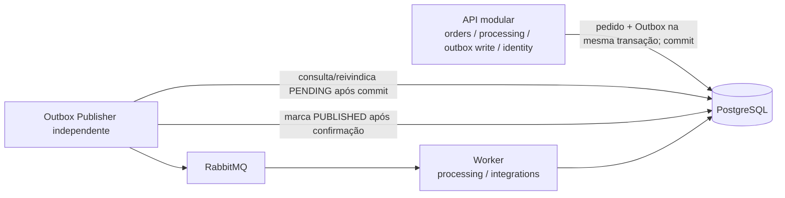

# ADR-001 — Monólito modular para API e worker separado

- **Status:** Accepted
- **Data:** 2026-11-01

## Contexto

O FlowBridge precisa receber pedidos por HTTP e executar integrações demoradas/falíveis de forma assíncrona. Vários microsserviços aumentariam infraestrutura e carga cognitiva antes de o domínio estar claro. Um único processo síncrono, por outro lado, obrigaria a API a esperar frete/faturamento e deixaria falhas externas dentro do ciclo da requisição.

## Decisão

Organizar a API como monólito modular com módulos de negócio (`orders`, `processing`, `integrations`, `outbox`, `identity`, `shared`) e executar o consumidor como worker Spring Boot separado. API e worker compartilham PostgreSQL nesta versão educacional e comunicam intenção/eventos por RabbitMQ, não por chamada HTTP síncrona entre processos.

Os módulos são limites de código no mesmo deployment da API, não serviços independentes. Criar abstrações somente quando houver regra/limite real; não abrir um projeto por módulo. API e worker usam a mesma base e schema PostgreSQL nesta versão, com credenciais runtime separadas e permissões mínimas por responsabilidade.

### Responsabilidade e acesso ao PostgreSQL

- Um usuário proprietário de schema/migrations é usado apenas por Flyway na etapa de migração. API e worker não executam DDL nem usam essa credencial em runtime.
- A API grava pedidos, itens, idempotência, Outbox e solicitações de reprocessamento; lê recursos de negócio dentro do escopo autorizado por `client_id`/principal.
- O worker lê pedido e itens para processamento; grava estado de processamento, tentativas, execuções de integração, inbox e timeline. Seu usuário não pode criar pedidos, alterar idempotência ou administrar schema.
- Grants devem ser explícitos por tabela e operação; quando apropriado, restringir atualizações a colunas de estado/generation. Não usar superuser para processos da aplicação.
- Dono lógico: API é dona do ciclo de criação do pedido/idempotência/Outbox; worker é dono das gravações de execução; o status compartilhado do pedido é atualizado pelo worker conforme a máquina de estados documentada.

## Como funciona

O controller HTTP traduz contrato para caso de uso; domínio mantém regras/transições; infraestrutura implementa JPA, banco, broker e adaptadores. O worker lê um evento e executa o caso de uso de processamento em seu processo. PostgreSQL guarda fonte de verdade e histórico.

## Problema resolvido e motivo

- Separa requisição rápida de trabalho lento.
- Torna testáveis as regras sem impor deployment distribuído a cada módulo.
- Ensina boundaries, consistência eventual e mensageria com custo local razoável.
- Permite observar disponibilidade/escala separada do worker quando isso for útil.

## Alternativas

- **Monólito totalmente síncrono:** mais simples, mas não atende processamento desacoplado e retry de mensagem.
- **Vários microsserviços com banco próprio:** fronteiras mais isoladas, mas traz comunicação, deploy, observabilidade e consistência distribuída desnecessários no escopo atual.
- **API e worker no mesmo processo:** menor operação inicial, mas piora isolamento de ciclo de vida; segue possível como alternativa se deployment local ficar excessivamente complexo.

## Consequências e limites

- API e worker acoplam-se ao contrato dos eventos e ao esquema PostgreSQL. Migrations precisam ser compatíveis com os dois; definir um dono lógico por tabela e um único processo migrador.
- Banco compartilhado é deliberado para primeira versão, não recomendação geral para microsserviços.
- A fila não oferece execução exatamente uma vez. Worker precisa tolerar redelivery.
- Um deployment simples não traz alta disponibilidade; HA/SLA estão fora de escopo.

## Como testar

Testes de domínio isolados; integração de migrations/repositories com PostgreSQL real; teste com RabbitMQ real para evento; prova de que iniciar API não inicia worker embutido; falha/restart e redelivery; revisão de que nenhuma regra crítica ficou dentro do controller.

## Aprovação

Direção de monólito modular, worker separado e PostgreSQL compartilhado preservada. Credenciais distintas, responsabilidades, grants mínimos e dono único de migrations foram aprovados na conclusão da Fase 0. A implementação dos papéis/grants continua pendente para a Fase 1; este ADR não cria usuários nem infraestrutura.
